# DONGENS · DSI仿真教学版

一个**纯前端**的 DSI Platform（DSI）行为仿真器，面向学生替代笨重的原版安装。
没有后端、没有依赖、不联网、不烧录任何硬件——双击 `index.html` 即可运行。

---

## 一、快速开始

**方式 1（最简单）**
直接双击 `index.html`，用 Edge / Chrome 打开。

**方式 2（推荐，避免个别浏览器的 file:// 限制）**
双击 `start.bat`，会自动起本地服务并打开浏览器。

```
start.bat          →   http://127.0.0.1:8931/
```

---

## 二、启动门户与项目管理

打开后**先进入启动门户**（对齐 DSI Platform 启动界面）。

### 三个视图

门户右侧会根据中间的动作项切换，共有三个视图：

#### ① 打开现有项目

```
最近使用的
┌──────────────────────────────────────────────────────┐
│ 项目                    路径              上一次更改  │
│ 1117.ap16      C:\...\Automation\1117   2026/11/17… │
└──────────────────────────────────────────────────────┘

浏览   删除                              打开
```

- **双击项目行** → 直接打开
- **单击选中 → 点「打开」** → 也可以
- `浏览` 导入 `.dongens.json` 文件
- `删除` 移除项目

#### ② 创建新项目

点中间「创建新项目」进入表单页：

| 字段 | 默认值 | 说明 |
|---|---|---|
| 项目名称 | `项目1`（自动全选） | 不能含 `\ / : * ? " < > \|` |
| 路径 | `C:\Users\Administrator\Documents\Automation` | 可编辑，右侧 `…` 为浏览 |
| 版本 | `V16` | V15.1 / V16–V20，**仅作记录，不影响仿真行为** |
| 作者 | `Administrator` | |
| 注释 | 空 | 多行文本框 |

点右下角「创建」→ 出现 **"正在创建项目..."** 进度框（约 0.5 秒）→ 自动切到新手上路页。

> 项目名重复时会询问是否覆盖。

#### ④ 显示所有设备（设备与网络）

点左侧「设备与网络」或引导页的「设备与网络」进入。

- 项目里**还没有设备**时：空白画布 + 提示"项目中还没有设备"
- **已添加设备**后：以卡片形式显示每个设备的名称、型号、订货号
- 右上角三个视图按钮：详细信息 / 列表 / 缩略图（当前为统一卡片视图）
- **双击设备卡片** → 进入工程并打开设备组态页

#### ⑤ 添加新设备

点动作栏「添加新设备」进入，结构对齐真实 DSI：

```
添加新设备

设备名称：[PLC_1]

┌────────┐  ┌─────────────────────┐  ┌──────────────────┐
│ 控制器 │  │ ▾ 控制器            │  │ 设备：           │
│  HMI   │  │   ▾ DONGENS S7-1200 │  │   CPU 1215C...   │
│ PC系统 │  │     ▾ CPU           │  │                  │
│  驱动  │  │       CPU 1211C...  │  │ 订货号：6ES7...  │
└────────┘  │       CPU 1212C...  │  │ 版本：V4.4       │
            │       CPU 1215C...  │  │ 说明：125 KB ... │
            │       ...           │  └──────────────────┘
            └─────────────────────┘
                                           [添加]
```

**已收录的 S7-1200 CPU 型号（22 个）**，含真实订货号与完整技术说明：

| 系列 | 型号 |
|---|---|
| 1211C | AC/DC/Rly、DC/DC/DC、DC/DC/Rly |
| 1212C | AC/DC/Rly、DC/DC/DC、DC/DC/Rly |
| 1214C | AC/DC/Rly、DC/DC/DC、DC/DC/Rly |
| **1215C** | AC/DC/Rly、**DC/DC/DC（班级最常用）**、DC/DC/Rly |
| 1217C | DC/DC/DC |
| 1212FC | DC/DC/DC、DC/DC/Rly（故障安全型） |
| 1214FC | DC/DC/DC、DC/DC/Rly（故障安全型） |
| 1215FC | DC/DC/DC、DC/DC/Rly（故障安全型） |
| SIPLUS | 极端条件型、非特定 CPU 1200 |

> **CPU 1215C DC/DC/DC** 的订货号是 `6ES7 215-1AG40-0XB0`，版本 V4.4，
> 125 KB 工作存储器，DI14×24VDC / DQ10×24VDC / AI2 / AQ2。
> 左侧类别里还列了 HMI / PC 系统 / 驱动，但这三类本仿真器未收录具体型号。

#### ③ 新手上路

创建成功后停在这里（对齐真实 DSI）：

```
项目："<项目名>"已成功打开。请选择下一步：

     ┌──────┐
     │ 开始 │
     └──┬───┘
        │
        ├─▶ 设备与网络        组态设备
        ├─▶ PLC 编程          创建 PLC 程序
        ├─▶ 运动控制 & 技术    组态工艺对象      ← 本仿真器未实现
        ├─▶ 驱动 参数设置      参数设置驱动      ← 本仿真器未实现
        ├─▶ 可视化            组态 HMI 画面      ← 本仿真器未实现
        │
        └─▶ 项目视图          打开项目视图      ← 主入口
```

可用的入口：

| 入口 | 行为 |
|---|---|
| 设备与网络 | 进入工程 → 打开设备组态页 |
| PLC 编程 | 进入工程 → 打开程序块总览 |
| **项目视图** | **进入工程 → 打开 OB1**（最常用） |
| 运动控制 / 驱动 / 可视化 | 明确提示"尚未实现" |

### 底部状态栏

```
▶ 项目视图 │ 已打开的项目：C:\Users\Administrator\Documents\Automation\项目1
```

路径随当前项目动态变化，未打开项目时显示"未打开项目"。

### 标题栏

```
DONGENS  -  C:\Users\Administrator\Documents\Automation\项目1
```

工程名后出现 `●` 表示有未保存改动。

### 在线 / 离线（V34）

工具栏上「在线」右边多了一个「离线」，两个是互斥的状态：

| 点「在线」 | 点「离线」 |
|---|---|
| 建立连接；**首次上线自动进入 RUN**（不用再按 RUN） | CPU 先 **STOP**，停扫描 |
| **自动开启监视**（梯形图直接显示通电导线与值气泡） | 监视自动关闭 |
| **自动打开「仿真 · 外部接线图」标签页** | 过程映像 **Q / M 清零**（等同 MRES），循环计数归零 |
| 循环计数**从 0 重新开始**（仿真面板右上角"循环 xxx"从 1 开始） | 断开在线，**自动关闭"仿真 · 外部接线图"标签页** |
| 梯形图切到**只读**：不能选中、不能拖、不能插、不能删、双击不改操作数 | 恢复可编辑 |
| 只允许在监视模式下**按住 NO / NC 触点改状态** | — |

只读时想改程序，点「离线」即可恢复编辑；改完再下载/上线。

> 上线 = 进入调试状态，所以「在线」「监视」「仿真面板」这三件事做成一键联动：
> 不用再手动点监视开关、也不用去项目树里翻仿真面板的标签页。

> 为什么在线要只读：真实DSI在线视图里的程序是 CPU 里的副本，改它没有意义（改了也不生效），
> 必须先离线改、再下载。这里做成一样的规矩，也顺便避免在线时点来点去把图形搞乱。


### 项目保存在哪里

**保存在浏览器本地**（localStorage）。刷新页面、关浏览器、第二天再开都还在。
首次使用时自动创建一个示例项目，所以门户不会是空的。

| 操作 | 位置 | 效果 |
|---|---|---|
| **保存项目** `Ctrl+S` | 菜单「项目 → 保存项目」 | 写回浏览器本地，出现在最近项目列表 |
| **自动保存** | 无需操作 | 有改动时每 4 秒自动落盘，状态栏显示保存时间 |
| **另存为文件** | 菜单「项目 → 另存为文件」 | 导出 `.dongens.json`，可拷贝/备份 |
| **浏览…** | 门户「打开现有项目」左下角 | 导入 `.dongens.json` 文件 |
| **删除** | 同上 | 从最近项目列表移除 |
| **返回启动页** | 菜单「项目 → 关闭项目并返回启动页」 | 自动保存后回门户 |

> 标题栏工程名后出现 `●` = 有未保存改动，自动保存后消失。
> 清空浏览器数据会连同项目一起清掉，重要工程请用「另存为文件」导出备份。

---

## 三、它和真实DSI一致的地方

| 方面 | 实现情况 |
|---|---|
| **界面布局** | 标题栏 / 菜单栏 / 工具栏 / 项目树 / 标签页 / 编辑器 / 巡视窗口 / 右侧指令面板 / 状态栏 |
| **项目树结构** | 完整层级（见下方《项目树结构》），全部节点可逐级展开/折叠 |
| **指令面板** | 选项 / 收藏夹 / 基本指令 / 扩展指令，分层折叠 + 搜索 + 拖放插入 + 右键收藏 |
| **指令集** | **101 条指令**（87 个盒式 + 触点线圈），见下方《支持的指令清单》 |
| **LAD 梯形图** | 触点、线圈、任意盒式指令、并联分支、EN/ENO、参数显示 |
| **SCL 结构化文本** | IF/ELSIF/ELSE、FOR/TO/BY、WHILE、REPEAT/UNTIL、完整运算符优先级、AND/OR/XOR/NOT/MOD |
| **软 PLC 内核** | 循环扫描、I/Q/M/DB 存储区、符号表解析、位/字节/字/双字寻址、EN 门控 |
| **编译诊断** | 语法错误定位到行、未定义符号、缺失 OB1、空网络警告、参数不完整 |
| **下载流程** | 8 步进度 → **真实装载**（编译产物装入软 PLC、建立实例、启动扫描）→ 自动打开仿真面板 |
| **在线监视** | 梯形图按功率流**逐段**着色（导线亦着色：导通绿实线 / 断开蓝虚线）、**按住常开/常闭触点临时改状态、松开复位**、元件值气泡、循环计数、扫描周期 |
| **强制表** | 强制值覆盖程序输出，可随时解除 |
| **监控表** | 实时值刷新、支持手动写值（置位输入点调试） |
| **工程管理** | 保存为 JSON、导出 DongensML 风格 XML、导出诊断报告 |

### 设备组态（机架视图）

项目树 → 设备组态，进入机架视图（对齐真实 DSI）：

```
PLC_1                              ← 左上角蓝色斜标

┌────┬────┬────┬────┬────┬────┬────┬────┬────┐
│ 1  │ 2  │ 3  │ 4  │ 5  │ 6  │ 7  │ 8  │ 9  │  ← 槽号
├────┼────┴────┴────┴────┴────┴────┴────┴────┤
│ CPU│          （空插槽，可右键插入模块）    │
│图形 │                                        │
└────┴────────────────────────────────────────┘
```

**第 1 槽固定是 CPU**，图形按真实 1215C 前面板绘制（DONGENS 标、型号串、
RUN/STOP/ERROR 指示灯、两排接线端子、网口）。第 2–9 槽为空，可插入模块。

右侧是**设备概览**树：`PLC_1 → 1215C DC/DC/DC → DI 14/DQ 10、AI 2/AQ 2、
HSC_1~6、Pulse_1~4、OPC UA、PROFINET`。

### 右键菜单（不同位置内容不同）

**右键 CPU**（21 项，对齐截图）：

| 菜单项 | 行为 |
|---|---|
| 更改设备 | 提示需重新添加 |
| 剪切 / 复制 / 粘贴 / 删除 | 单 CPU 场景下禁用或提示 |
| 转到拓扑视图 / 网络视图 | 未实现，明确提示 |
| **编译** | 真正执行编译 |
| **下载到设备** | 真正执行下载流程 |
| **转至在线 / 转至离线** | 真正切换在线状态 |
| **在线和诊断** | 打开诊断页 |
| 分配设备名称 | 显示当前 PROFINET 名称 |
| 交叉引用 / 调用结构 / 分配列表 | 调用结构打开程序块总览，分配列表打开变量表 |
| **显示目录** | 展开右侧指令面板 |
| **导出模块标签条** | 导出 DongensML XML |

**右键空插槽**：插入模块… / 粘贴（禁用）/ 删除（禁用）/ 属性 / 拓扑 / 网络
→ 「插入模块…」可选 DI / DQ / DI/DQ / AI / AQ / AI/AQ / CM 七种模块，插入后画布显示模块图形

**右键已插模块**：更改设备 / 剪切复制粘贴（禁用）/ **删除** / 属性 / 编译 / 拓扑 / 网络

**右键画布空白**：添加新设备… / 显示目录 / 编译 / 下载 / 拓扑 / 网络

> 底部还有「属性」表和「系统时钟存储器」配置（勾选后变量表自动多出 8 个时钟位）。

### 关闭右侧指令面板

指令面板标题栏有三个按钮：

| 按钮 | 作用 |
|---|---|
| `▤` | 折叠为竖排（省空间但仍可展开） |
| `📌` | 固定 |
| **`✕`** | **完全关闭，释放宽度的 100%** |

关闭后可通过菜单「**视图 → 显示 / 隐藏指令面板**」重新打开。
关闭状态会记住（存 localStorage），下次打开保持。

#### 中线对齐

梯形图里**所有元素的中线必须是同一条水平线**。触点和线圈曾多加了 6px 偏移，
导致导线看起来错位——现已统一为 `y + h/2`，实测同一网络内 8 条引线的 y 值完全一致。

选中线段的样式也改为**蓝色虚线**（原来是橙色，容易被误认为卡住）；
点空白处立即取消选中。

### 仿真面板（外部接线图）

**下载后会自动打开仿真面板；点「在线」也会自动打开它并同时开启监视**：

```
┌────────────────────────────────────────────────────┐
│ 仿真·外部接线图  CPU:RUN 循环86   自锁|点动 全部复位  │
├────────────────────────────────────────────────────┤
│ 软 PLC 状态  输入导通：1/3  输出导通：1/2  周期 0.10ms │
├────────────────────────────────────────────────────┤
│ 输入（I）    ● I0.0    ● I0.1    ○ I0.2            │
│              "Start"   "Stop"    "Sensor"          │
├────────────────────────────────────────────────────┤
│ 输入（M）    ○ M0.0                                │
│              "Auto_Mode"                           │
├────────────────────────────────────────────────────┤
│ 输出（Q）    ● Q0.0    ○ Q0.1                      │
│              "Motor"   "Alarm"                     │
├────────────────────────────────────────────────────┤
│ 输出（M）    ● M0.0                                │
│              "Auto_Mode"                           │
└────────────────────────────────────────────────────┘
```

**接口说明**：圆形，灰色=无信号，绿色=有信号。

#### 数量完全由变量表决定（V35）

面板不再按 CPU 1215C 固定补 14 个输入 / 10 个输出，
而是**扫「默认变量表」，只给 Bool 类型的位地址生成接口**：

| 变量表里的地址 | 面板上出现的位置 | 行为 |
|---|---|---|
| `I0.0` `I0.1` …（Bool） | 输入（I） | 可点的开关，写 `plc.mem.I` |
| `M0.0` `M1.3` …（Bool） | 输入（M） | 可点的开关，手动给中间位注入信号，写 `plc.mem.M` |
| `Q0.0` `Q0.1` …（Bool） | 输出（Q） | 只读的灯，跟随 `plc.mem.Q` |
| `M0.0` `M1.3` …（Bool） | 输出（M） | 只读的灯，观察程序写进 `M` 的值（与输入 M 同一个位） |

规则细节：

- **只看 Bool**：`MW10`(Int)、`MW12`(Int)、`MD20`(DInt) 这种整字/非 Bool 变量**不会**变成开关
- **同一地址只出现一次**：变量表里两行都写 `I0.0`，面板上也只有一个
- **地址排序**：按字节、位升序（`I0.0 → I0.1 → I0.2 → I1.0`）
- **某组为空**：给一句灰字提示（例：`变量表里没有 Bool 类型的 M 地址（例如 M0.0）`），不留空白框
- **改完变量表不用重开面板**：面板每周期比对地址指纹，加了 `I0.3` 会自动重建

> 举例：变量表里只有 `I0.0`、`I0.1`、`Q0.1`、`M0.0` → 面板上就正好是
> 2 个输入开关（I）、1 个输入开关（M）、1 个输出灯（Q）、1 个输出灯（M），
> 其他什么都没有。

M 组用**紫色标签 + 虚线边框**和物理 I/O 区分：M 是中间变量（位存储器），
不是端子上的真实接线点。把它也做成开关，是为了能在不接外部信号的情况下
单独验证"某个中间位为 1 时程序怎么走"（真实DSI里用监控表/强制表做这件事）。

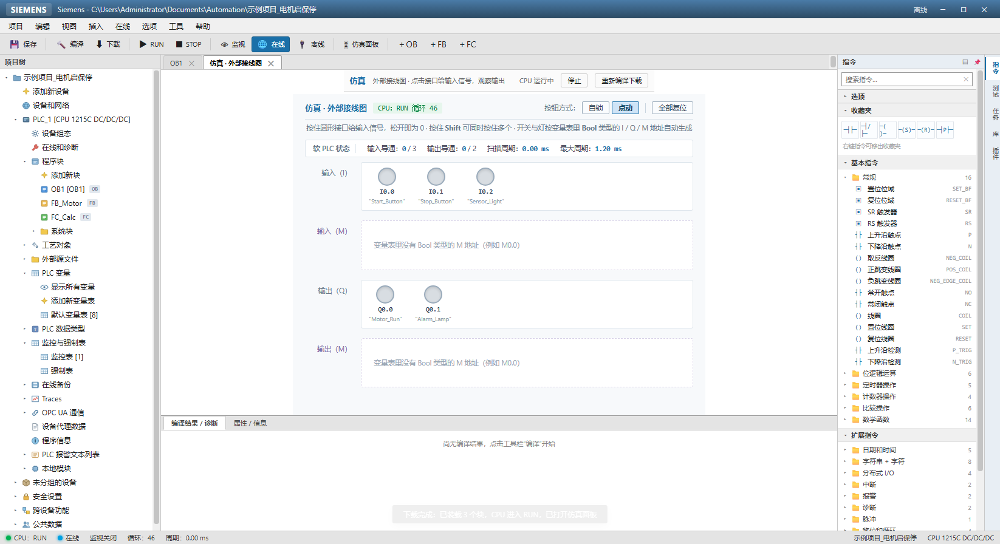

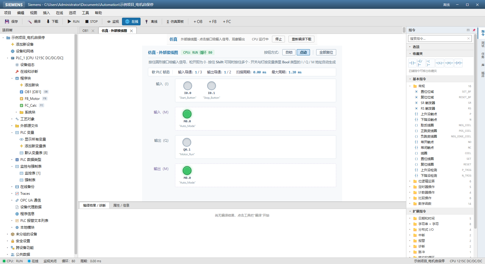

#### 两种按钮方式

| 模式 | 行为 |
|---|---|
| **点动**（默认） | 按住有信号，松开鼠标立即失去（像机台的点动按钮） |
| **自锁** | 点一下锁住（保持信号），再点一下取消（调机时常亮某个输入） |

> v33 起默认改成**点动**：真实的启动/停止按钮本来就是"按住才给信号"，
> 默认自锁容易出现"点一下 I0.0，线圈就一直亮着"的误会——
> 那是 PLC 程序里的自锁在起作用，不是按钮卡住了。

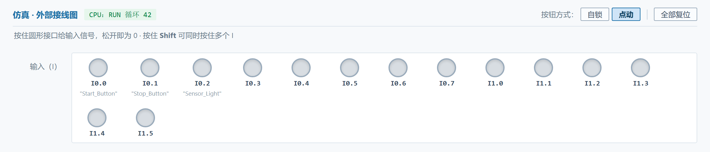

#### Shift 多选

按住 **Shift** 依次点击多个 I 接口 → 可以同时点亮多个输入；
**松开 Shift** → 所有通过 Shift 按下的 I 接口同时停止。

> 面板上的每一次点击都**真实写入软 PLC 的 I 区**，
> Q 区读取的是 PLC 程序的真实输出结果——不是模拟动画。

### 编辑器缩放

LAD 编辑器**右下角**有缩放控件（对齐 DSI）：

- 滑块：50% ~ 150% 连续调节
- 下拉框：50 / 60 / 70 / 80 / 90 / 100 / 110 / 120 / 130 / 150%
- 切换标签页后缩放比例保持不变

### 编辑区滚动行为

LAD 编辑器采用**三层固定布局**，滚动时头部不会被截断（对齐真实 DSI）：

```
┌──────────────────────────────┐
│ OB1  主程序（循环执行） 编译 切换 │ ← 固定，不滚动
├──────────────────────────────┤
│ [NO] [NC] [P] ... [TON] [R] [S] │ ← 固定，不滚动
├──────────────────────────────┤
│ 块标题： Main Program Sweep     │ ← 固定，不滚动
│ 注释   主程序循环执行…          │
├──────────────────────────────┤
│ 网络 1： 电机启保停控制          │ ↕ 只有这块滚动
│   ...                         │
└──────────────────────────────┘
```

滚轮上滑/下滑时，块头、收藏夹、块标题**始终停在原位**，只有网络区滚动。

### 操作数输入（对齐 DSI）

**插入元件不弹窗** —— 直接显示红色占位符 `<??.?>`：

```
  ──┤├──        ← 刚插入：红色 <??.?> 提示未填操作数
```

**双击元件就地输入**（不弹对话框）：

```
  ┌──────────────────┬────────┐
  │ I0.0             │ 选择… ▾│   ← 内联编辑框
  └──────────────────┴────────┘
```

| 行为 | 说明 |
|---|---|
| **自动大写** | 输入 `i0.0` 立即变成 `I0.0`（保持光标位置） |
| **下拉候选** | 显示变量表里的地址 + 符号名；不足时补常用 I/Q/M 位地址 |
| **自动建变量** | 填的地址不在变量表里时，自动创建 `Tag_1`、`Tag_2` … |
| **回车确认** | `Enter` 提交，`Esc` 取消 |
| **符号名联动** | 地址若已在变量表，自动带出对应符号名 |

**显示结构**（对齐 DSI 截图）：

```
      I0.0            ← 蓝绿色：绝对地址（双击改这里）
   "Start_Button"     ← 黑色：符号名（双击改这里 / 在变量表里改）
  ──────┤├──────
```

> 触点/线圈双击本体 = 编辑地址；盒式指令（TON 等）双击仍是多参数表单。

#### 地址选择下拉

变量表每个地址单元格右侧有 `▾` 箭头，点击弹出**自绘下拉面板**
（不用浏览器原生 datalist，选项多时更可靠）：

```
┌─────────────────────────────┐
│ [输入筛选，如 I0 / MW / 启动] │
├─────────────────────────────┤
│ 变量表中的地址                  │
│   I0.0    Start_Button       │
│   Q0.0    Motor_Run          │
├─────────────────────────────┤
│ 位地址                        │
│   I0.0  I0.1  I0.2 … I4.7    │
├─────────────────────────────┤
│ 字地址                        │
│   IB0  IW0  ID0  MB0  MD20 … │
└─────────────────────────────┘
```

| 能力 | 说明 |
|---|---|
| 分组 | 变量表地址 / 位地址 / 字地址 三类 |
| 实时筛选 | 输入 `MD` 只剩字地址与匹配项 |
| 符号提示 | 变量表地址右侧显示符号名 |
| 键盘 | `Esc` 关闭，`Enter` 选中第一个 |
| 智能定位 | 下方空间不足自动向上翻 |

共约 200 个候选地址，按 I/Q/M 区 0~4 字节全位 + 常用字地址生成。

### 可拖拽属性面板

设备组态页面下方有一个**可伸缩的属性面板**（对齐真实 DSI）：

```
┌─────────────────────────────────────────────┐
│ （收起时）：PLC_1 [CPU 1215C DC/DC/DC]  属性 信息 诊断 ▴ │
├─ 拖动这条分隔条可上下调整高度 ─────────────────┤
│ 常规 │ IO 变量 │ 系统常数 │ 文本              │
├──────────────┬──────────────────────────────┤
│ 系统和时钟存储器 │  系统存储器位                  │
│ Web 服务器     │  ☑ 启用系统存储器字节           │
│ 支持多语言      │  地址(MBx)：[1]                │
│ 时间           │  首次循环：%M1.0               │
│ 防护与安全      │  诊断状态已更改：%M1.1          │
│ OPC UA         │  ...                          │
└──────────────┴──────────────────────────────┘
```

| 操作 | 效果 |
|---|---|
| **双击分隔条** | 展开 / 收起面板 |
| **拖动分隔条** | 上下调整面板高度（180–620 px） |
| 点右侧 ▴/▾ 箭头 | 同样展开/收起 |
| 点上部四个标签 | 切换 常规 / IO 变量 / 系统常数 / 文本 |
| 点左侧属性树 | 切换右侧配置内容 |

### 系统存储器 vs 时钟存储器

这两个是**独立的两组配置**，都在「系统和时钟存储器」页里：

**① 系统存储器字节**（默认 MB1，4 个固定功能位）

| 位 | 功能 | 行为 |
|---|---|---|
| .0 | 首次循环 | 仅 CPU 进入 RUN 的第 1 个扫描周期为 1 |
| .1 | 诊断状态已更改 | 诊断缓冲区条目数变化时置 1 一周期 |
| .2 | 始终为 1（高电平） | 恒为 1 |
| .3 | 始终为 0（低电平） | 恒为 0 |

**② 时钟存储器字节**（默认 MB0，8 个不同频率方波）

| 位 | 频率 | 周期 |
|---|---|---|
| .0 | 10 Hz | 100 ms |
| .1 | 5 Hz | 200 ms |
| .2 | 2.5 Hz | 400 ms |
| .3 | 2 Hz | 500 ms |
| .4 | 1 Hz | 1 s |
| .5 | 0.5 Hz | 2 s |
| .6 | 0.625 Hz | 1.6 s |
| .7 | 0.3125 Hz | 3.2 s |

> 两者都由 CPU 每扫描周期刷新，**会覆盖用户程序写入**（与真机一致）。
> 启用后对应位会自动出现在变量表中（只读，带浅色底标记）。

### 项目树结构

与真实 DSI Platform 项目树一致，全部节点带小三角可逐级展开：

```
项目名（如 1117 / 示例项目_电机启保停）
├─ 添加新设备
├─ 设备和网络
├─ PLC_1 [CPU 1512SP-1 PN]
│   ├─ 设备组态
│   ├─ 在线和诊断
│   ├─ 程序块
│   │   ├─ 添加新块
│   │   ├─ OB1 [OB1]
│   │   ├─ FB_Motor
│   │   ├─ FC_Calc
│   │   └─ 系统块
│   ├─ 工艺对象
│   ├─ 外部源文件
│   ├─ PLC 变量
│   │   ├─ 显示所有变量
│   │   ├─ 添加新变量表
│   │   └─ 默认变量表 [8]        ← 方括号里是变量数量
│   ├─ PLC 数据类型
│   ├─ 监控与强制表
│   │   ├─ 监控表 [1]
│   │   └─ 强制表
│   ├─ 在线备份
│   ├─ Traces
│   ├─ OPC UA 通信
│   ├─ 设备代理数据
│   ├─ 程序信息
│   ├─ PLC 报警文本列表
│   └─ 本地模块
├─ 未分组的设备
├─ 安全设置
├─ 跨设备功能
└─ 公共数据
```

**交互规则**：

| 操作 | 效果 |
|---|---|
| 点 **小三角 ▸/▾** | 只展开/折叠，不打开 |
| 单击**容器节点**（如"程序块"） | 展开/折叠 + 选中 |
| 单击**叶子节点**（如 `OB1`） | 打开对应编辑器 |
| 双击叶子节点 | 同样打开 |

展开状态会**记住**（存在 localStorage，按项目区分），切项目或重新打开都不丢。
「添加新块」可直接点开新建；块和变量表数量变化后树会自动刷新。

### 编辑器交互（V2 / V3）

| 操作 | 效果 |
|---|---|
| **拖拽元件** | 按住元件直接拖动（不需要抓手）：跨列、跨网络、插入空槽，拖动时绿色虚线提示落点 |
| **拖拽导线端点** | 左侧母线旁的小圆点（悬停网络时出现）拖到下方便新增并联分支；拖到别的网络则把该分支整体搬过去 |
| **右键元件** | 编辑操作数 / 复制 / 左插列 / 右插列 / 加并联 / 加入收藏夹 / 删除 |
| **右键网络** | 加并联分支 / 追加列 / 插入网络 / 删除网络 |
| **Delete 键** | 删除选中元件（全局生效，不受焦点影响） |
| **Ctrl+D** | 复制选中元件 |
| **F2 / 双击** | 编辑操作数或指令参数 |
| **拖指令面板到梯形图** | 在落点插入该指令；落点有绿色虚线提示 |
| **双击面板指令** | 追加到当前网络末尾 |

### LAD 收藏夹工具栏

LAD 块的**块标题下方、网络上方**有一条固定的收藏夹工具栏（对齐 DSI）：

```
┌────────────────────────────────────────────────┐
│ □_□  □_/□  □_P□  □_N□  ( )  [TON]  (R)  (S)  ↺ │  ← 收藏夹
├────────────────────────────────────────────────┤
│ 网络 1： 电机启保停控制                          │
│   ...                                          │
└────────────────────────────────────────────────┘
```

| 操作 | 效果 |
|---|---|
| **从右侧指令面板拖入** | 加入收藏夹（拖到收藏栏任意位置都行，会有蓝色高亮提示） |
| **右键指令 → 加入 LAD 收藏栏** | 加入收藏夹 |
| **单击收藏项** | 选中（蓝色边框） |
| **双击收藏项** | 插入到当前网络 |
| **从收藏项拖到梯形图** | 在落点插入 |
| **右键收藏项** | 菜单：插入到当前网络 / 删除该收藏项 / 排序… / 恢复默认收藏 / 清空收藏夹 |
| ↺ 按钮 | 恢复默认 8 项 |

> **Delete 键不再删除收藏项**（太容易误触，会把指令从收藏栏里点没）。
> 删除请用**右键菜单 →「删除该收藏项」**。垃圾桶按钮也已去掉，
> 「清空收藏夹」「恢复默认收藏」同样收进右键菜单。

#### 排序模式（V29）

右键收藏项 →「排序…（拖动调整顺序）」进入排序模式：

```
┌────────────────────────────────────────────────┐
│ □_□  □_/□  □_P□  □_N□  ( )  [TON]  (R)  (S)  ↺ │ ← 只有这一条保持正常颜色
└────────────────────────────────────────────────┘   （其它区域整体变灰变暗）
                    拖动图标调整顺序
                     ┌──────────────┐
                     │ 退出排序（Esc）│              ← 中间偏下
                     └──────────────┘
```

| 操作 | 效果 |
|---|---|
| 拖动图标 | 与相邻图标实时换位 |
| 按 `Esc` | 退出排序模式 |
| 点「退出排序（Esc）」（屏幕中间偏下） | 同上 |
| 退出时 | 新顺序自动写入 `dongens.ladFavbar`，刷新后保持 |

默认收藏：常开 `NO`、常闭 `NC`、上升沿 `P`、下降沿 `N`、线圈 `COIL`、`TON`、复位 `RESET`、置位 `SET`。

> 收藏内容保存在浏览器本地（`dongens.ladFavbar`），刷新/重开都还在。
> **双击指令面板里的指令仍然是"插入到当前网络"**，不改变原有习惯；
> 加入收藏夹请用拖拽或右键。

### 块标题与注释

LAD 块的编辑区从上到下依次是：

```
┌──────────────────────────────────────────────┐
│ OB1  主程序（循环执行）        编译此块 切换为 SCL │  ← 块头
├──────────────────────────────────────────────┤
│ [NO] [NC] [P] [N] [COIL] [TON] [R] [S]     ↺ │  ← 收藏夹
├──────────────────────────────────────────────┤
│ 块标题：  Main Program Sweep (Cycle)          │  ← 可编辑
│ 注释    主程序循环执行：每个扫描周期…          │  ← 可编辑（多行）
├──────────────────────────────────────────────┤
│ 网络 1： 电机启保停控制                        │
└──────────────────────────────────────────────┘
```

**块标题**和**注释**都可以直接在界面里点进去改：

| 字段 | 编辑方式 |
|---|---|
| 块标题 | 单击进入编辑，`Enter` 确认，`Esc` 取消，自动过滤换行 |
| 注释 | 单击进入编辑，支持多行；`Ctrl+Enter` 确认，`Esc` 取消 |

两者都是 **contenteditable + 纯文本粘贴**：从别处复制内容粘进来
不会带入 HTML 格式。修改后标签页出现 `●` 未保存标记，自动保存会自动落盘。

> 空值时会显示灰色斜体占位提示「（未填写块标题）」「（未填写注释）」。

### 元件显示与换类型（V5，对齐真实 DSI）

**每个触点/线圈上方显示两行标签**：

```
      I0.0                    ← 上：绝对地址（青绿色加粗）
   "Start_Button"             ← 下：符号名（带引号）
   ──┤├──                    ← 元件符号
```

| 操作 | 效果 |
|---|---|
| **单击元件** | 选中（蓝色虚线框）+ **弹出类型下拉**，可直接换成另一种触点/线圈 |
| **再次点击下拉项** | 立即切换类型，**操作数和地址保留不变** |
| **双击元件或它的标签** | 弹出操作数编辑框，可改符号或绝对地址 |
| **拖拽元件** | 换位置（跨列/跨网络） |

触点可选：常开 / 常闭 / 上升沿 / 下降沿
线圈可选：线圈 / 置位 / 复位 / 取反 / 正跳变 / 负跳变

> 拖拽基于 **Pointer Events** + `setPointerCapture`，不是 HTML5 drag&drop。
> 原因：SVG 子元素默认不可拖，`draggable` 对 SVG 无效，真人根本触发不了 `dragstart`
> （而自动化测试直接派发 DragEvent 会假通过——这正是 V2 里拖拽"看起来能用实际不能用"的原因）。

### 变量表（V3）

- **数据类型**：下拉框，12 种（Bool / Byte / Word / DWord / Int / DInt / Real / LReal / Time / Date / Char / String）
- **地址**：可编辑输入 + 候选列表（I/Q/M 区 0–8 字节的位地址与 B/W/D 地址）
- **保持性**：下拉框（非保持 / 保持）
- **新建变量按上一行递增**，与真实 DSI 一致：

```
上一行 M1.0  (Bool)  ->  新增 M1.1
上一行 M1.7  (Bool)  ->  新增 M2.0     （跨字节进位）
上一行 Q1.0  (Bool)  ->  新增 Q1.1
上一行 MW10  (Int)   ->  新增 MW12     （按类型宽度步进）
上一行 MD20  (DInt)  ->  新增 MD24
```

### 选中导线与插入分支

梯形图里的**每一段导线都可以点选**（对齐 DSI）：

| 操作 | 效果 |
|---|---|
| 单击一段导线 | 选中，显示蓝色虚线 |
| 选中后点收藏夹「→ 插入开放分支」 | 在**该列**下方分出并联支路 |
| 选中列间连接线后点「→」 | 在**该连接处**插入新的一列并联支路 |
| 点空白处 | 取消选中 |

**分支是从同一条线横向分出的，不是把原线截成两段**——与真实 DSI 一致。

#### 开放分支与关闭分支（V28）

对齐 DSI：从工具栏点「→ 插入开放分支」得到的是**开放分支**——从竖线横向分出，
右端**悬空**，末端画一个开口箭头 `»`，表示"这条分支还没接回主线"：

```
  ──┤ M100.0 ├──┬────────( M10.2 )──      ← 主线
                │
                └──────(?)──»             ← 开放分支（右端悬空）
```

数据上用一个占位节点 `OPEN_END` 标记分支末端，存档时一并保存。

| 图标 / 操作 | 效果 |
|---|---|
| **→ 插入开放分支**（第 1 个） | 生成一条开放分支，箭头固定在末端 |
| **↱ 关闭分支**（第 2 个） | 去掉开口箭头，分支右端**向上汇合**回主线（画出汇合竖线） |
| 向开放分支里插指令 | 指令落在箭头之前，箭头自动后移，分支始终是打开的 |
| 向开放分支里插线圈 | 线圈即分支终点，箭头自动消失，但**不汇合**（悬空输出） |
| 分支手柄圆点 | 默认不显示（鼠标正好压上去才淡淡露一下），单击在该列新增一条**开放分支** |

**只有闭合分支才画汇合竖线**；开放分支、线圈收尾的分支都不画，
所以不会再出现"空矩形闭环"。

#### 开口箭头只出现在分支末端（V30）

`OPEN_END` 只是"这条分支到此为止"的标记，不是元件，所以它只应该出现在
**并联分支（第 2 行及以下）的末尾**。v30 起加了三道保险，彻底清掉"主干导线中间
凭空冒出箭头"这类历史遗留：

| 场景 | v30 的行为 |
|---|---|
| 老工程数据里主干（第 1 行）带 `OPEN_END` | 打开/重绘时自动清掉，右下角标未保存；主干只画导线，不画箭头 |
| 在**开放分支内部**的线段处点「分支」 | 切开时把切口两端的 `OPEN_END` 一并收拢，**只保留新分支这一个箭头** |
| 切开后右半边因此变空的并联行 | 整行去掉，不会被"空行 → 开放分支"的归一化再变出一个箭头 |

> 主线永远要连到线圈，不可能"在中间结束"，所以主线里出现箭头一定是脏数据。

#### 盒式指令不再被压扁 + 拖箭头合并分支（V31）

**① 一行里的小格子按"元件需要多宽"分，不再平均分。**
以前一列里的宽度是 `列宽 / 本行元件数` 平均切，`[TON] »` 这种"一宽一窄"的行
会把 TON 压成半个格子（盒子只剩 70 多 px，文字挤成一团、两侧也挤不出引线，
看起来像盒子直接长在竖线上）。v31 起按每个元件 `elWidth()` 的比例分配，
并且列宽本身把盒式元件**两侧引线的 26px** 一起算进去，所以：
盒子拿到的是它真正需要的宽度，左右各留一段可见引线，盒子不再贴着汇合竖线。

**② 开口箭头可以拖着合并回去（对齐 DSI）。**

| 操作 | 效果 |
|---|---|
| 单击分支末端的开口箭头 | 整个网络里出现一排**小方块**（主线每个器件后一个 + 箭头处一个） |
| 按住开口箭头往主线方向拖 | 小方块跟着高亮，鼠标最近的落点变**绿色** |
| 松手落在绿色方块上 | 在该处把列切开，分支并入主线：左边留切点之前的元件，箭头收掉 |
| 松手落在空白处 | 取消拖动，什么都不改 |
| 松手落在**别的列**的方块上 | 在本列末端汇合（梯形图里分支只能在自己的列末汇合），并给出提示 |

拖的时候不会再弹出"↔ OPEN_END"的幽灵块，也不会冒出绿色的插入框 ——
拖动开口箭头走的是它自己的通道，和"挪动器件"互不干扰。

**③ 切线不再留空列。** 切点正好落在本列最后一个器件后面时（比如 §①里那条
`[TON] »` 分支拖到主线第 1 个器件之后），只把箭头收掉、不新建空列，
否则会多出一列空白，看起来像导线被凭空拉开一段。

**④ 没接线圈的主线要"拖出去"，不能收成方框（V31.1）。**

一条并联支路如果最后一格不是线圈，收口处会和汇合竖线一起闭合成一个**方框**，
看着像短路环。TIA 的做法是：主线继续往右画，末端用 `»` 表示"这条支路还没接完"：

```
  ──┤├──┬───────────»          ← 主线：没接线圈 → 一直拖到右边 + »
        │
        └──┤├──┘                 ← 分支：在自己的列末并入主线
```

规则（只影响显示，不动数据）：

| 主线最后一格是… | 末端 |
|---|---|
| 线圈 | 不画尾线（正常结束） |
| 器件 / 空 | 往右拖一段尾线，末端 `»` |
| 完全空白的新网络 | 保持原来的短封口，不拉长 |

顺带把开口箭头的字形改成了 DSI 的 `»`（双箭头）——分支末端的箭头、主线的悬空端
用的是同一个符号，不会一半单箭头一半双箭头。

#### 界面细节修正（V49）

**① 没选中元件时插分支，不再"连在母线上"。**

旧逻辑里没选中任何东西时 `colIdx` 默认 0，也就是**第 1 列**。而第 1 列的"分出竖线"
是和左侧母线重合的（画图时那一段直接由母线顶替），于是新建的开放分支引线看起来
像是**直接从母线上长出来**，和主线黏在一起：

```
  错（V48）                          对（V49）
  │                                   │
  ├──┤ I0.0 ├──[ CTU ]──»             ├──┤ I0.0 ├──┬─[ CTU ]──»
  │                                   │            │
  ├──────────»   ← 引线贴着母线        │            └──┤ I0.1 ├──»
  │                                   │
```

现在没选中元件 / 线段时，分支落在**最后一列**（和"没选中时追加指令"的落点一致），
竖线画在列边界上：

| 操作 | 落点 |
|---|---|
| 选中元件后点「→ 插入开放分支」 | 该元件所在列 |
| 选中某段导线后点「→」 | 该导线处先切开列，再在切点后挂分支 |
| 什么都没选就点「→」 | **最后一列**（第 1 列不再被默认占用） |
| 网络右键 →「在末尾列添加并联分支」 | 同上（菜单文案已同步改掉） |

**② 小圆圈默认不画。**

分支手柄 `·`（列左边界上那个小圆点）和元件左上角的拖拽手柄圆点，默认 `opacity: 0`；
只有鼠标正好压上去才淡淡显示，功能还在，但画面上不再到处是小圆圈。

**③ 收藏夹永远是一整排，不会换行。**

`.fb-cells` 从 `flex-wrap: wrap` 改成 `nowrap` + 横向滚动，`.fb-cell` 加 `flex: 0 0 auto`。
窗口变窄时指令往右排、出现横向滚动条，不会再出现"第二排只露出半个图标"的假换行。

**④ 只填数字的参数框里保持空白。**

比较指令下方的数字（`IN2`）和计数器的 `PV`，双击后是一个**纯数字输入框**：
placeholder 为空、不弹地址候选。以前这里会挂着灰色的 `I0.0 / Q0.0 / M10.0`，
和"这儿该填数字"这件事互相打架。触点 / 线圈的地址框不受影响，仍然有提示和候选。

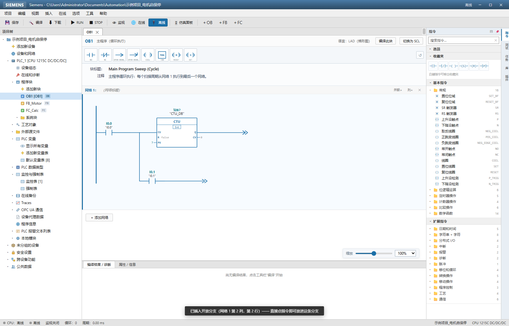

#### 监视模式：导线按功率流上色 + 按住触点改状态（V32）

**① 通电的不只是元件，导线也要变绿。**

以前监视模式只按"元件输出是否为 1"给元件上色，结构导线（汇合竖线、列间连线、
空分支直通线、悬空尾线）始终是静态的深蓝色，于是"电流走到哪儿了"看不出来。

v32 起，软 PLC 的每一遍扫描会把**导线级电位**一起记下来：

| trace 字段 | 含义 |
|---|---|
| `trace.net[n].elem[id].in / out` | 这个元件的**左引线 / 右引线**电位 |
| `trace.net[n].cols[c].in / out` | 这一列**入口 / 出口**电位 |
| `trace.net[n].cols[c].wires[w].out` | 这一列里第 `w` 个空档导线的电位 |
| `trace.net[n].final` | 能流是否走到线圈 |

画图时每根导线用 `data-live="colin:1"` 这样的**电位来源标签**记下"我该查哪儿"，
刷新时按标签重新上色 —— 不重建 DOM，所以监视刷新不会打断你正在做的选中和拖拽：

```
  ──┤ I0.0 ├──────┬────┤/I0.1├──────( Q0.2 )──      I0.0 = 0（断开）
    └─绿─┘  └蓝虚┘ │  └──绿──┘        └── 蓝虚 ──┘
                  │
    ──┤ M0.0 ├────┘                                 M0.0 = 1（导通）
      └──── 全绿 ────┘                               汇合竖线也是绿的
```

配色规则（和真实DSI一致）：

| 状态 | 表现 |
|---|---|
| 有电 | `#00b050` 绿色实线，2.6px |
| 没电 | `#1a6fa8` 深蓝**虚线**（`5 3`），1.6px |
| 离线（未监视） | 保持原来的深蓝实线 |

关键点：**一个触点的左右两根引线可以颜色不一样**。常开触点断开时，左边绿、
右边蓝虚线 —— 这才是"进线有电、出线没电"的真实样子。所以 CSS 从"整个元件一起变色"
改成了按 `in-live / out-live`、`in-dead / out-dead` 分别给左右引线上色。

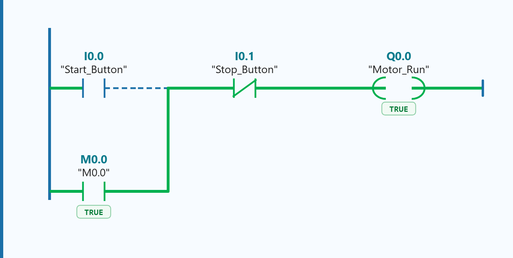

**② 按住触点就能改状态，松开自动复位（对齐 DSI 的"修改值"调试手法的简化版）。**

监视模式下，把鼠标按在**常开（`NO`）或常闭（`NC`）触点**上：

| 操作 | 效果 |
|---|---|
| 按住左键 | 该触点的操作数**取反**（`0→1` / `1→0`），立即重扫一遍并刷新画面 |
| 松开左键（或指针被取消） | 恢复成按住之前的值，再重扫一遍 |
| 按在线圈 / 盒式指令 / 导线上 | 没有任何反应（只对 `NO`、`NC` 生效） |
| 没开监视（离线）时按住 | 没有任何反应 |

所以按住一个常开触点，等于"临时把这个输入短接一下"：触点闭合、导线变绿、
后面的线圈跟着得电；手一松，一切回到原样。这个改动**不写进工程数据**，
也不会覆盖强制表（强制表仍然优先级最高）。

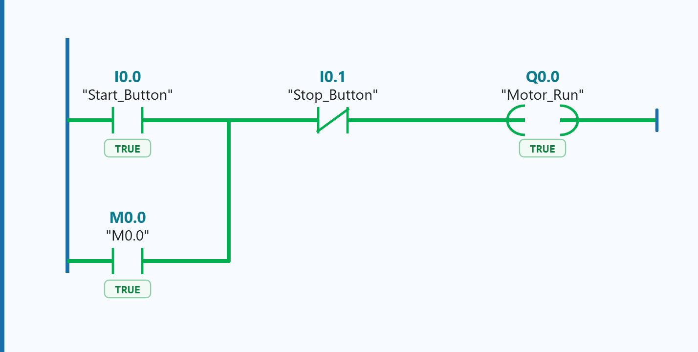

> 实现上按住时把 `ED.force = {plc, el, before}` 记在编辑器状态里，松开时写回
> `before`；按住期间 `ED.suppressClick = true`，避免随后的 click 又把触点类型
> 下拉菜单弹出来。

#### 监视值气泡放在器件下方（V33）

监视时元件上的值（`TRUE` / `FALSE` / 计数、时间等数值）之前画在**符号上沿往下 12px**，
而"地址 + 符号名"两行标签正好占着这一带，于是 `TRUE` 会和 `I0.0` / `"Start_Button"`
叠成一团，字挤着字看不清。

v33 起把气泡挪到**导线下方**那条空白带里，做成一颗浅绿药丸：

```
      I0.0                 ← 地址（cy-26）
     "Start_Button"        ← 符号名（cy-14）
 ────┤ ├───────           ← 导线（cy）
      ┌──────┐            ← 值气泡（cy+13 ~ cy+25）
      │ TRUE │
      └──────┘
```

- 触点符号只到 `cy±9`、线圈半圆到 `cy±10`，行底在 `cy+34` —— 这一带本来就是空的
- 气泡宽度按单元格宽度收（超出会截断成 `…`），不会溢出到汇合竖线上
- 值气泡与元件同属一个渲染层但**不进元件组**，所以不会被选中框、拖拽手柄带走
- 顺手治了个老毛病：以前 `lad.js` 渲染时画一次、`app.js` 刷新时又新建一个 `.lt-val`，
  同一个值有两套画法（位置还不一样）。现在统一由 `LAD.syncBadges()` 负责增删改

> **V34 补一刀：两行标签自己再上移 6px。**
> 气泡搬走后，露出来的其实是标签本身——`"Start_Button"` 的字底边（约 `cy-6`）
> 和触点符号顶（`cy-9`）本来就在啃着，只是以前被 `TRUE` 挡着不明显。
> 现在地址行 `cy-26`、符号名行 `cy-14`，字底边到 `cy-12`，和符号顶留出 3px 空隙。

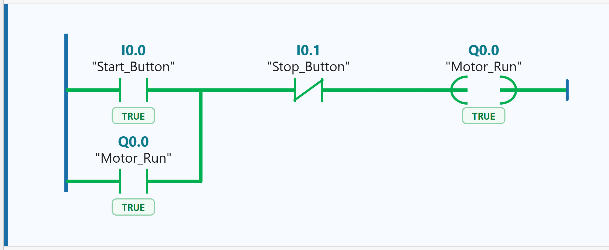

#### 竖线与 Delete（V28）

每个并联分支由三段可交互的线组成：

```
  ──┤├──┬──────( )──┤     ← 主线
         │
         └──────( )──┤     ← 分支
       ↑分出竖线  ↑汇合竖线
```

| 可点对象 | 单击 | Delete |
|---|---|---|
| **两器件之间的导线**（V29 新增） | 选中：淡蓝底 + 蓝色虚线 | 不可单独删（有提示） |
| **汇合竖线**（右侧，按行分段） | 选中蓝色虚线 | **只断开这根线**：分支变成开放分支，元件全部保留 |
| **分出竖线**（左侧） | 选中 | 不可单独删（有提示） |
| **开口箭头** | 选中 | 删掉箭头 = 闭合分支；空分支则整行删除 |
| **左母线** | 选中 | 不可删（有提示） |
| **空分支直通线** | 选中 | 删除该分支 |

> **V29：同一列里两个器件之间的那段线现在也能选中了。**
> 之前只有"列与列之间"的连线有命中区，列内器件之间只有元件引线（点它等于选元件），
> 所以那段线看着像"点不中"。现在按元件符号的命中框把整段线切成小段：
> **点符号 → 选元件，点符号之间的线 → 只选中那一段导线**（淡蓝底 + 虚线）。
>
> 每一小段都有独立的编号（`net:span:col:row:k`，`k` = 这段线**左边有几个元件**），
> 所以同一列里有多个空档时，**只高亮你点中的那一段**，不会把整行一起点亮。
>
> **在这个位置点「分支」，分支就分在这里**（对齐 DSI）：编辑器会先按 `k` 把当前列切开
> （左边留 `k` 个元件，右边是剩下的），再把开放分支挂到右半列上。
> 所以点第 1 个空档就在第 1 个元件后面分出竖线，不会再"跑到整列前面去"：
>
> ```
>   ──┤A├──┤B├──┤C├──       点 A、B 之间的线 → 点「分支」
>        ↓
>   ──┤A├──┬──┤B├──┤C├──
>          │
>          └─────────────»    ← 开放分支（开口箭头在末尾）
> ```
>
> `k = 0`（第一个元件之前）不切列，分支直接在本列左边界分出；
> `k = 元件数`（最后一个元件之后）则在右边新开一列来挂分支。
>
> 汇合竖线按行分段绘制，所以两条闭合分支可以**各自断开**，互不影响。
> 分支断开后想再合上，点「↱ 关闭分支」即可。

### 导线对齐规则

所有列共享**同一套行基线**，第 1 行（主线）始终贴在顶部，多分支向下扩展：

```
  ──┤├──┬──┤/├──( )──        ← 主线（第 1 行，所有列在同一高度）
        │
        └──┤├──┤/├──( )──     ← 第 2 条并联支路（向下分出）
```

两列分支数不同时，用**阶梯汇合**：少的一侧在最后一条分支处水平接入，
再用一条**竖线**把多出的分支收拢——**不会出现斜线**。

- 分出竖线画在**该列左边界**；第 1 列紧贴左母线，母线本身就是竖线，不再重复画
- 汇合竖线画在该列右边界（按行分段），从主线一直连到最后一条**闭合**分支
- 末列没有汇合竖线时，补一根末端封口竖杠

#### 分支长短不一时，元件不会被"撑开"

一条并联支路里加器件，列宽会跟着变宽（列宽 = 这一列里最长那条分支需要的宽度），
但**短分支里的元件仍然贴在列的左边界**，多出来的宽度变成行尾的导线：

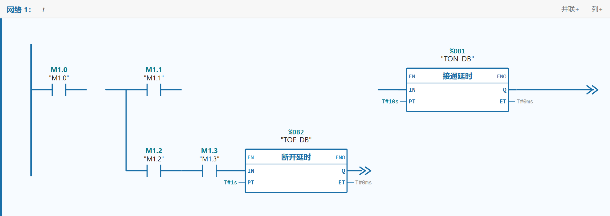

如果按比例把短分支拉伸去填满列宽，元件就会被推到列尾、前面空出一大截没有器件的线，
看起来像"在下面加一个器件，上面那行的器件整体往后挪了"。现在按元件**自然宽度**从左往右排，
只有自然总宽超过列宽时才压缩，所以插入器件不会推动同一列其他行的元件。

#### 导线不会断：行尾补线、分支行跨列也连线

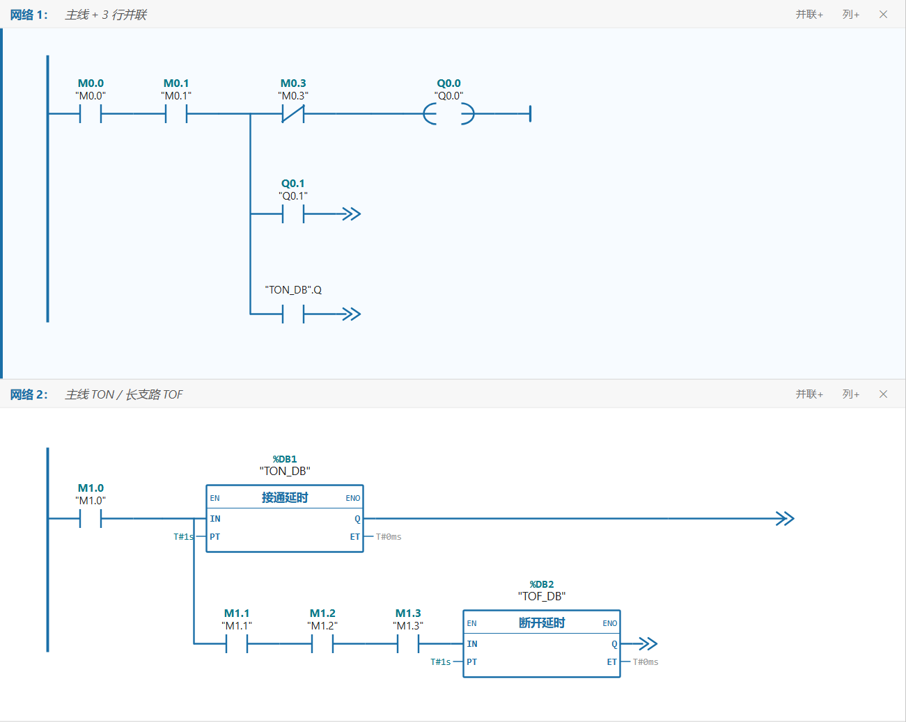

按自然宽度排版会留下两类"空档"，都必须补成导线，否则看着就是断线：

| 空档位置 | 原因 | 处理 |
| --- | --- | --- |
| 列内、最后一个元件右边 | 列宽由最长分支决定，短分支排完还剩下宽度 | 从最后一格右缘补一条导线到列右边界 |
| 列与列之间的 30px 间隙 | 原来只给主线（第 1 行）画了列间连线 | 凡是相邻两列都存在的行都画，且上一列该行不是"收尾"（开口箭头 / 线圈）时也照画 |
| 开口箭头没顶到列尾 | `OPEN_END` 只占 34px，箭头停在半路 | 开口收尾的格子延伸到列右边界，箭头落在列尾（但**不与汇合竖线相接**） |

收尾的行（开口箭头、线圈）不会往右多连一根线——分支到那里就结束了，
多连反而会让两条支路在视觉上"接错"。

回归测试 `test-wire-gap.js` 逐行扫描 SVG 里该行的水平导线，把导线和元件单元格取并集，
只要列内或列间出现 >1.6px 的空档就报断线；里面还带一条**反向自检**
（主动删掉一根行尾导线、必须报出断口），避免"全部通过"其实是扫描器什么都没查。

### 删除元件的行为

删除元件后该处**导线直接连通**，不会残留 `EMPTY` 占位框——与真实 DSI 相同。
删掉并联分支里最后一个元件时，**整行分支一起删除**，
不会留下"空闭合环"这种没有内容却还画着汇合竖线的怪图形。

## 支持的指令清单（101 条）

**常规 / 位逻辑**：常开 `NO`、常闭 `NC`、线圈 `COIL`、置位 `SET`、复位 `RESET`、取反线圈 `NEG_COIL`、
上升沿 `P`、下降沿 `N`、正跳变线圈 `POS_COIL`、负跳变线圈 `NEG_EDGE_COIL`、
**置位位域 `SET_BF`、复位位域 `RESET_BF`、SR 触发器 `SR`、RS 触发器 `RS`**、
字逻辑 `AND_W / OR_W / XOR_W / INV_W`

**定时器**：`TON` 接通延时、`TOF` 断开延时、`TP` 脉冲、`TONR` 时间累加、`RESET_TIMER`

### 定时器（TON / TOF / TP / TONR）的使用要点

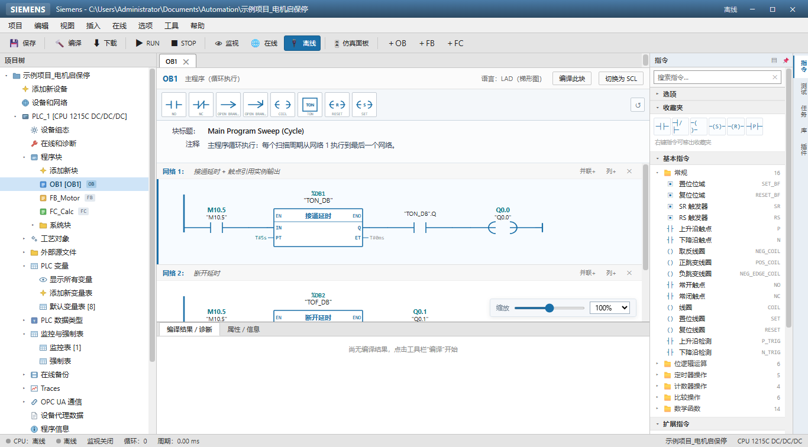

- 块头是 `TON` + `Time`，**没有 EN/ENO**（博途默认不显示，这里也不显示）。
- 盒体上的 `IN` / `Q` 是**功率流端子**（和真实 DSI 一样靠接线，不再画红色 `<???>` 占位）：
  从左边进来的功率流就是 `IN`，从右边出去的功率流就是 `Q`。
  因此 `M10.5 → TON(PT=T#5s) → (Q0.0)` 里的线圈要**等 5 s 到点**才得电；
  `TOF` 则是输入断开后 `Q` 继续导通 `PT` 这么长，时间到才断开。
- `PT` / `ET` 的时间写法：`T#5s`、`T#1m30s`、`T#500ms`；
  也接受省略前缀的 `5s` / `1,5s`（入库时自动规范成 `T#5s` / `T#1.5s`），纯数字按毫秒解释。
  编辑完成后统一回写 `T#…`，不会丢 `T#` 前缀；旧工程里存的 `5s` 会在打开时自动补齐。
- 实例数据块成员可以被触点/线圈引用：`"TON_DB".Q`（Bool，可作触点）、
  `"TON_DB".IN`（Bool）、`"TON_DB".PT` / `"TON_DB".ET`（Time，不能作触点）、
  `"TON_DB".CV` 等计数器成员（Int）。编译诊断会检查实例/成员是否存在、类型能不能接触点；
  给实例成员写线圈会被判为"只读输出"错误。
- **在线监视**时只有 `ET` 在走（橙色的已过时间，显示在 `ET` 引脚右侧）；
  `PT` 永远是设定值，不倒数、不跳动。

#### 置位 `-(S)-` / 复位 `-(R)-`

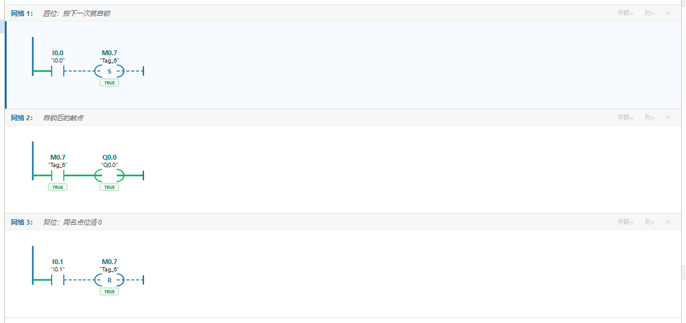

| 指令 | 行为（照搬博途 / IEC） |
| --- | --- |
| `-(S)-` 置位 | 前面**通一下电**就把点位置 1，之后哪怕前面断电也**自己保持** |
| `-(R)-` 复位 | 前面**通一下电**就把同一点位清 0，把自锁解开 |
| `-( )-` 普通线圈 | 每周期跟随功率流，不保持 |

- `S` / `R` 写的是**同名点位**：`-(S)- M0.7` 与 `-(R)- M0.7` 是一对，
  `R` 得电就把 `S` 置起来的电断掉。
- 存储区不挑：`M` 区（`M0.7`、`M10.0`…）和 `Q` 区都能保持；
  `M` 区断电保持是靠扫描不覆盖实现的，所以别在别处用普通线圈重复写同一个地址
  （那会每周期被覆盖，看起来像"置位没反应"）。
- 操作数可以写符号名、绝对地址，也认 DSI 那种带引号的写法 `"Tag_6"`；
  符号表没同步时自动退回地址，写入失败还会在诊断缓冲区留一条警告，
  不会再"静默无效"。
- **置位后线圈本身变绿**：自锁时前面那个触点已经松开、功率流是 0，但位还是 1，
  所以 `-(S)-` 的线圈（连同里面的 `S` 字母）一直保持绿色，一眼就能看出"置位了、还保持着"；
  `-(R)-` 一旦得电把它清 0，线圈立刻变回蓝色。
  `-(R)-` 和普通线圈仍按功率流着色 —— 复位线圈不会因为"位碰巧是 1"就变绿（那会误导）。

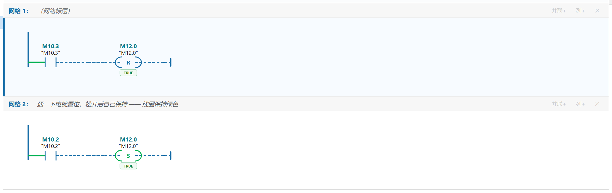

#### 在线监视：值画在引脚旁

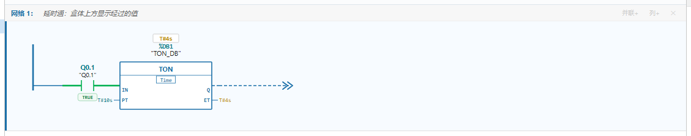

- **盒体上方的值框**就是"当前值"：定时器显示**经过的时间**（`ET`，如 `T#3.4s`），
  计数器显示**当前计数**（`CV`）。它跟着扫描周期刷新，到点后停在 `PT` 上。
- 引脚旁也各有一份：定时器 `ET` 的已过时间画在 `ET` 引脚右边（橙色），
  `PT` 保持设定值不动（以前 `PT` 会倒计时，看着像"值在乱跑"，已修正）。
- 计数器：`CV` 的当前计数值画在 `CV` 引脚右边（橙色）。
- 线圈 / 触点：值画在符号下方的小气泡里。
- 双击参数改值时，输入框贴着**你双击的那个文字**弹出；重新渲染会先把它收掉，
  不会留下飘在半空的残留输入框。
- 值框只在**在线监视**时出现；离线时那块空间是空的，切换监视时版式不会跳。
- 一个网络里上下排两个定时器/计数器时，行距是按最高的盒体算的
  （盒体高度 + 上方值框 + `%DBn` + 实例名），下一个不会压到上一个的底边。

#### 定时器的框外值不会被分支竖线压住

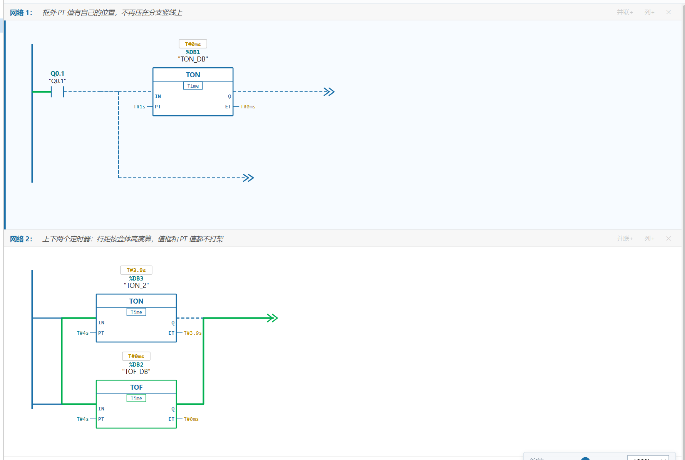

定时器的 `PT`、`ET`（计数器是 `PV`、`CV`）写在盒体外面。这些值以前只按普通盒体留 12px 引线，
一旦这一列还挂着并联分支，值就会溢到格子边上、和分支那条竖线挤在一起（看起来就像"盒体被分支压住"）。

现在定时器 / 计数器在格子里左右各留出一块**写值区**：左边 56px（`PT` 值 + 短引线）、右边 44px（`ET` 值）。
所以分支竖线永远落在值的外面，`PT` 值也完整落在自己这一列里；同样，双击框外值弹出的输入框、
点击命中区都不会越过格子去盖住那条竖线。

#### 并联分支：开口支路不会"漏电"

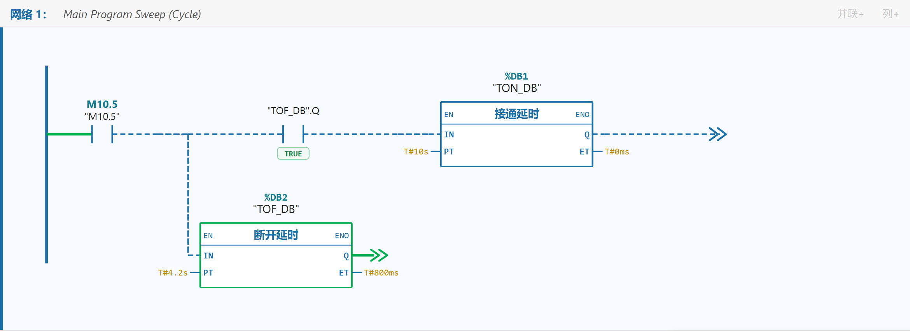

一条以**开口箭头**（工具栏"OPEN_BRAN"）收尾、或直接以**线圈**收尾的分支，表示它就在这里结束、
不汇合回右边。这类分支的功率流**不会**并入下一列：上图的 `TOF` 在按钮松开后仍会按 `PT`
保持 `Q=1`（这是 TOF 的定义，不是自锁），但它右边那条开口支路不会把电送给后面的 `TON`，
所以 `"TON_DB".ET` 会立刻清零、`Q` 断开。

判断方法看在线监视的颜色：

- **绿实线** = 这一段的功率流为 1；**蓝色虚线** = 为 0（断电）。
- 定时器盒体左边绿、右边也是绿，说明它在"接通延时"；左边变蓝虚线、右边还是绿，
  说明它正处于 **TOF 的断开延时保持**（输入已断、Q 还在保持）。
- 松开按钮后如果只有某个 `TOF` 还绿着，而它右边的 `TON`/线圈都变蓝虚线 —— 这是正常的断开延时。

**计数器**：`CTU` 加计数、`CTD` 减计数、`CTUD` 加减计数、`RESET_COUNTER`

**比较**：`CMP` `==`、`CMP_NE` `<>`、`CMP_GT` `>`、`CMP_LT` `<`、`CMP_GE` `>=`、`CMP_LE` `<=`

### 基本指令的块头与引脚（照搬博途）

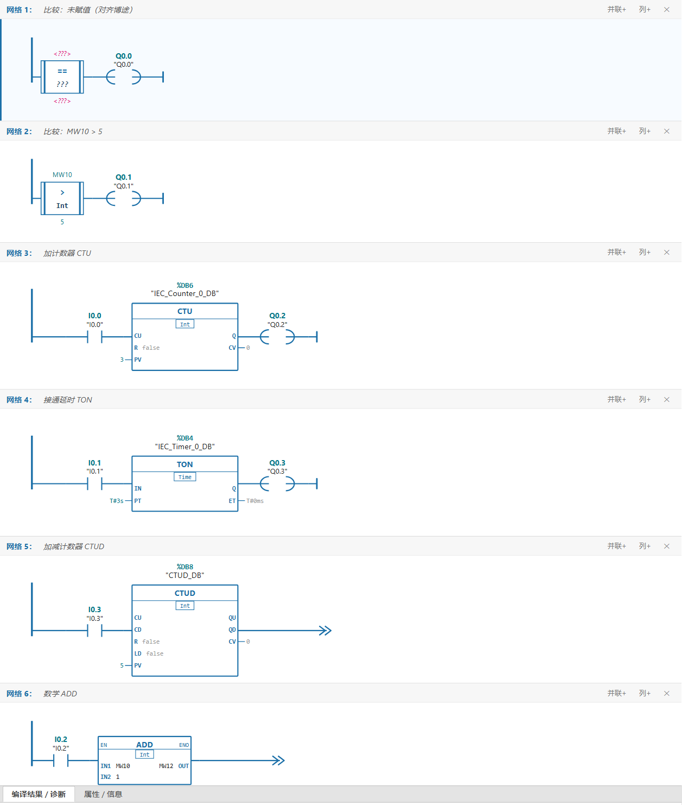

盒体上的标题一律是**博途的助记符**（`TON` / `CTU` / `ADD` / `MOVE`），
中文名只出现在指令窗格和属性里；标题下面那行小框是**数据类型**（`Time` / `Int`）。
参数名（`IN` / `PT` / `CU` / `CV`…）就是博途的引脚名，不是自己编的。

#### 比较指令是"触点"，不是盒体

博途里 `CMP` 系列串在功率流中间、结果是 Bool，所以**没有 EN/ENO**，也不是两行 `IN1`/`IN2`。
画面是：

```
   <???>          ← IN1，没填就是红字
 ┌─────────┐
 │   >     │      ← 比较符
 │ Int / 5 │      ← 数据类型；没选类型但下面填了数字时，这里就显示那个数字
 └─────────┘
   <???>          ← IN2
```

- 双击上面 / 下面的 `<???>` 直接填操作数；双击盒里的 `Int` 选数据类型（`Int`/`DInt`/`Real`/`Time`/`Bool`）。
- **下面填了数字，盒里那行就显示这个数字**（不再是永远的 `???`）：
  `==` 上方是关联值 `"TON_DB".PT`，盒里显示 `5`，下方是 `5`，一眼能看出"比较值已经生效"。
  只有既没选类型、也没填数字时才显示 `???`；选了类型（`Int` / `Time`…）时优先显示类型。
- **比较取的是关联实例"正在跑的那个数"**，不是数据块里冻结的设定值：
  - 定时器：取**经过值**（就是盒体上方那个值框里正在走的数）。所以 `"TON_DB".PT` 写的是 PT 设了
    `T#10s`，下面填 `5`，含义就是"**跑到 5 秒时比较成立**"；写 `.ET` 完全等价。
  - 计数器：取**当前计数 CV**（写 `.CV` 或 `.PV` 都按当前计数比），`CV` 到 5 时比较成立。
- 指令上方**不再额外加值框**：要看当前值，直接看定时器 / 计数器盒体上方那个值就行，
  比较指令本身只负责"到点闭合"。
- 操作数可以是常量、绝对地址、符号，**也可以是实例成员**：`"T1".ET`、`"CTU_DB".CV`
  （双击 `<???>` 时下拉列表里会列出当前块里的定时器 / 计数器实例，选中后再挑成员，
  比较指令的成员后面会标"运行值"）。
  这正是"上面可以关联 TON / TOF / 计数器"的用法。
- 只有比较成立时功率流才往后走，和触点的行为完全一致。

#### 比较指令下面那个数字怎么算

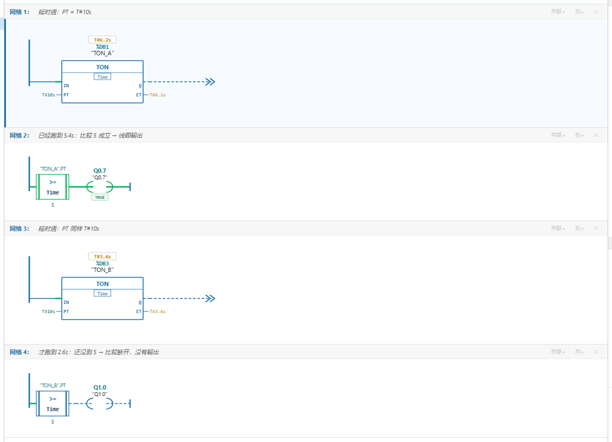

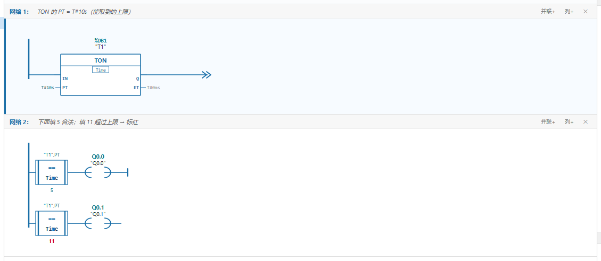

一边关联了实例成员（`"T1".PT`、`"CTU_DB".CV`），另一边就可以直接填**常量数字**当开关用：

| 关联的对象 | 单位 | 下面填 `5` 等于 | 备注 |
| --- | --- | --- | --- |
| `"T1".PT` / `"T1".ET`（Time） | **秒** | 经过值到 `T#5s` | 也可写 `T#500ms`、`500ms`、`5s` |
| `"CTU_DB".CV` / `.PV`（Int） | 数字 | 当前计数到 `5` | 计数器按普通整数比，**不按时间** |
| `MW10` / `MD20`（Int / DInt / Real） | 数字 | `5` | 按地址声明的类型 |

- 支持**小数点后两位**：`5.25` = `T#5.25s`（Time）或 `5.25`（Real）。`,` 当小数点写也认。
- 写三位小数（`5.255`）不行，直接提示"小数最多两位"。
- **填的数字超过关联值能取到的上限 → 标红**：数字本身变红，鼠标悬停显示原因，
  并且编译报 `error`、下载被拦住。例：`PT = T#10s`，比较写 `"T1".PT == 11`，
  因为 PT 最大也就 10s，`11` 永远等不到 → 标红 + 下载中止。
  正好等于上限（`== 10`）是合法的，不标红。

#### 计数器：CU / R / PV | Q / CV

| 引脚 | 方向 | 含义 |
| --- | --- | --- |
| `CU` | 功率流输入 | 每个**上升沿**计 1（按住不放只算一次） |
| `R` | Bool 输入 | 为 1 时 CV 清 0，**优先于计数**；没接线显示灰色 `false` |
| `PV` | Int 输入 | 设定值，**没赋值就是红色 `<???>`**（它是整数，不再是 `T#10ms`） |
| `Q` | Bool 输出 | `CV >= PV` 时为 1 |
| `CV` | Int 输出 | 当前计数值，在线监视时橙色数字跟着涨 |

`CTD` 换成 `CD` / `LD` / `PV` | `Q` / `CV`（`LD=1` 把 PV 装进 CV，`CV<=0` 时 Q=1）；
`CTUD` 是 `CU` / `CD` / `R` / `LD` / `PV` | `QU` / `QD` / `CV`。
三个计数器都**没有 EN/ENO**，和博途一样。

实例成员也能被引用：`"CTU_DB".Q`（Bool 触点）、`"CTU_DB".CV`（Int，可进比较指令）。

#### R / LD 端可以接一条触点支路（V50）

博途里 `R` 不只是"填个 `false`"，它还能像 CU 一样**接一条支路**：从左边母线拉一根线、
串几个触点，直接进盒体左边的 `R` 引脚。现在照这个来：

```
        ┌─────────────────────────────┐
   ─────┤ I0.0        CTU             │
        │             Int        Q ───┼──→
        │  ┌─────────── R             │
        │  │     5 ─── PV       CV ───┼──→
        │  │
        │  └───┐                       （R 的引线在盒内第二行，支路在盒外拐上去）
   ─────┤ I0.1 ├───┘
     ●  └──────┘      ← 小圆点：这条支路是从母线取的电
    母线
```

| 操作 | 效果 |
| --- | --- |
| 右键计数器 →「R 端接一条触点支路…」 | 从母线拉出一条支路，放一个常开触点，并立刻弹出地址输入框 |
| 右键盒体 →「在 R 端再加一个触点（串联）」 | 支路里串联第二个触点（= AND） |
| 右键支路上的触点 | 改为常闭 / 再加一个 / 删除这个触点 / 删除整条支路 |
| 双击支路上的触点 | 改地址（和主线上的触点一样，走内联编辑） |
| 支路触点按 Delete | 只删这一个；删完了整条支路自动消失，`R` 恢复显示灰色 `false` |

要点（照搬博途的语义）：

- 引脚支路**从母线取电**，不经过前面那些列 —— 所以 `CU` 断开（前面的触点没通）时按复位照样能复位。
- 一条支路里串多个触点就是 `AND`；接常闭触点则相当于"不按就一直复位"。
- 引脚支路**不参与列/行的功率流**：它只决定这个引脚的电平，不会被算进「列输出 OR」。
- 支路里的操作数一样要过编译检查（地址写错会报错、下载被拦住）。
- 支路会把计数器往右挪一点、给左边的触点让位置（和博途一样，盒子左边永远留出支路的空间）。
- **监视着色逐段刷新**：支路导线和起点的小圆点都带 `data-live` 标签，每个扫描周期按 `trace.pin` 重新上色
  —— 触点一闭合，它右边那一段马上自己变绿；断开又退回蓝色虚线（不用重画整个网络）。

`CTD` 的 `LD` 端同理；`CTUD` 的 `R` / `LD` 两端都能接（同时接时会各自排一条子行）。

#### R / LD 脚上的接线小方块（V51）

`R` 这个输入脚的左边框上有一个**小方块**，就是博途里那个接线端子：

| 状态 | 样子 |
| --- | --- |
| 还没接支路 | 空心白底小方块（提示"这里可以接线"），`R` 后面照旧显示灰色 `false` |
| 接了支路 | 变成实心小方块（已连接），支路导线正好停在方块的左边缘 |

- 双击小方块 = 接一条触点支路，和右键菜单「R 端接一条触点支路…」是同一件事。
- 已经接了支路后双击，等于再串一个触点（最多 3 个）。
- 删掉整条支路后，小方块会自动退回空心状态。
- `CTD` 只有 `LD` 一个方块；`CTUD` 有 `R`、`LD` 两个方块，各在自己的引脚行上。
- 方块跟着盒体一起在在线监视里变色（盒体绿它就绿）。
- 支路那一行比网络最后一行还低，所以**左母线会跟着往下延伸**到最下面那条支路，支路起点的小圆点正好落在母线上 —— 不会出现"触点悬空"。
- 触点一闭合，**从起点小圆点到 R 方块整条支路自己变绿**（含小圆点）；断开退回蓝色虚线。

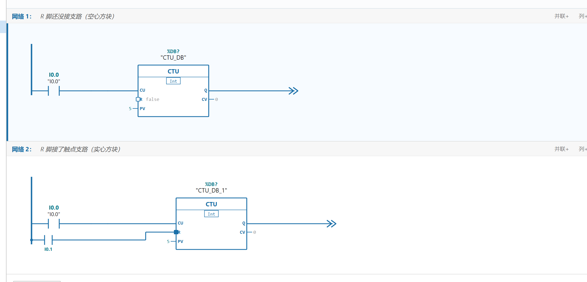

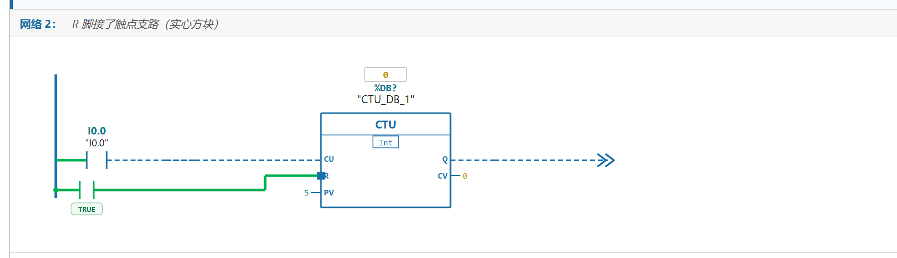

**数学**：`ADD` `SUB` `MUL` `DIV` `MOD` `ABS` `MIN` `MAX` `LIMIT` `NEG` `INC` `DEC` `SQR` `SQRT`

**移动**：`MOVE`、`MOVE_BLK`、`FILL_BLK`、`SWAP`

**移位 / 循环**：`SHL`、`SHR`、`ROL`、`ROR`

**转换**：`CONVERT`、`ROUND`、`TRUNC`、`CEIL`、`FLOOR`

**日期和时间**：`T_ADD`、`T_SUB`、`T_DIFF`、`T_CONV`、`RTC`

**字符串**：`LEN`、`CONCAT`、`LEFT`、`RIGHT`、`MID`、`FIND`、`EQ_STR`、`NE_STR`

**脉冲**：`PULSE`

**程序控制**：`RET`、`JMP`、`LABEL`

**工艺（运动控制）**：`MC_POWER` 使能轴、`MC_MoveAbsolute` 绝对定位、`MC_Home` 回原点、`MC_Halt` 停止轴
（仿真实现：记录使能/完成状态，不做真实插补运算）

**通信**：`TSEND_C` 发送、`TRCV_C` 接收、`GET` 读取远程、`PUT` 写入远程、
`MB_CLIENT` Modbus 客户端、`MB_SERVER` Modbus 服务器
（仿真实现：返回 DONE/NDR 握手状态，不建立真实连接）

**分布式 I/O**：`RDREC`、`WRREC`、`PE_START`、`PE_END`

**中断 / 报警 / 诊断**：`ATTACH`、`DETACH`、`SET_ALARM`、`GET_ALARM`、`GET_DIAG`、`LED`

> 标注「仿真」的指令（分布式 I/O、PROFIenergy、中断、报警、诊断）在仿真器里返回成功状态码，
> 不模拟真实总线通讯——这类能力依赖实际硬件，网页环境无法提供。

## 四、它有意不做的事

- **不连接真实 PLC**，不涉及 PROFINET / S7 协议 / 网卡
- **不烧录任何硬件**，所有"下载"都是装载到内置 JS 软 PLC
- 无硬件组态编辑（设备组态页是只读展示）
- 无 WinCC HMI（未实现画面编辑器）

---

## 五、十分钟上手

### 1. 打开示例工程
启动后默认加载 `Project1`，OB1 里有三个已写好的网络：

- **网络 1 · 电机启保停**：`Start_Button` 并联 `Motor_Run` 自锁，串 `Stop_Button` 常闭
- **网络 2 · 工件计数**：`Sensor_Light` 上升沿 → `Part_Count` 加 1 → 到 100 报警
- **网络 3 · 运行计时**：`Motor_Run` 接通后 TON 计时，每秒累加 `Run_Time_MS`

### 2. 编译 → 下载 → 监视
```
点工具栏「编译」  →  巡视窗口出现编译结果
点工具栏「下载」  →  8 步进度条走完，CPU: RUN
点工具栏「监视」  →  OB1 梯形图开始着色
```

> 懒一点的做法：直接点工具栏「**在线**」——它会一次性把 CPU 拉到 RUN、打开监视、
> 并弹出「仿真 · 外部接线图」面板，省掉「监视」和翻标签页两步。

### 3. 触发输入，观察输出
打开左侧 **监控表**，在 `I0.0` 对应行的「修改值」输入框里打 `true` 回车。
- `Q0.0` 立刻变 `TRUE`（自锁生效）
- 再把 `I0.0` 写 `false`，`Q0.0` **仍然保持 TRUE**（这就是自锁）
- 把 `I0.1` 写 `true`，`Q0.0` 断开

这就是真实 PLC 的启保停逻辑，行为和现场一致。

### 4. 编辑梯形图
- 工具条点「常开触点」→ 自动插入一列 → 弹窗选操作数
- **双击任意元件** → 改操作数
- 点中元件后按 **Delete** → 删除
- 点「并联」→ 给第一列加一条并联支路
- 网络标题可直接点进去改

### 5. 改 SCL 代码
项目树点 `FB_Motor` 进入 SCL 编辑器，改完按 **Ctrl+Enter** 编译。
故意删掉一个 `END_IF`，再编译——看巡视窗口怎么报错（带行号）。

### 6. 保存工作
- **Ctrl+S** → 下载 `Project1.dongens.json`
- 菜单「项目 → 打开项目」→ 载回你的工程
- 菜单「项目 → 导出为 XML」→ 得到可 diff 的 DongensML 风格文件

---

## 六、快捷键

| 快捷键 | 功能 |
|---|---|
| `Ctrl+S` | 导出工程 JSON |
| `Ctrl+Enter` | 编译当前编辑器 |
| `Ctrl+M` | 开启 / 关闭监视 |
| `Ctrl+L` | 下载到设备 |
| `Delete` | 删除选中的 LAD 元件 |
| 双击元件 | 编辑操作数 |

---

## 七、支持的操作数与数据类型

**地址格式**（与DSI一致）

```
I0.0   Q0.1   M10.2         位
IB2    IW4    MD20          字节 / 字 / 双字
DB1.DBX0.0   DB1.DBW2       数据块内

T#5s   T#1s500ms   T#2m     时间字面量
```

**字面量**：在 CMP / MATH 里可以直接写数字，如 `Part_Count >= 100`。

**支持的数据类型**：`Bool` `Byte` `Word` `DWord` `Int` `DInt` `Real` `Time` `Char`

---

## 八、文件结构

```
dongens-n26/
├── index.html         页面骨架（三栏布局：项目树 / 编辑器 / 指令面板）
├── start.bat          一键启动（本地 HTTP 服务）
├── css/
│   └── tia.css        TIA 风格样式表
├── js/
│   ├── plc.js          软 PLC 内核（地址解析 / 扫描 / LAD求值 / SCL解释器 / 编译检查）
│   ├── instructions.js 指令目录与执行器（83 条指令定义 + CATALOG 结构）
│   ├── store.js        项目存储层（浏览器本地持久化 + 最近项目索引 + 导入导出）
│   ├── portal.js       启动门户（最近项目表 / 双击打开 / 新建 / 浏览 / 删除）
│   ├── tree.js         项目树（完整层级 + SVG 图标 + 展开状态记忆）
│   ├── devicecatalog.js 硬件目录（S7-1200 22 个 CPU 型号 + 订货号 + 说明）
│   ├── racks.js        设备组态机架视图（9 槽 + CPU 图形 + 命中几何）
│   ├── propspanel.js   可拖拽属性面板（四标签 + 属性树 + 存储器配置）
│   ├── favbar.js       LAD 收藏夹工具栏（拖入添加 / 右键删除 / 拖动排序 / 持久化）
│   ├── blockheader.js  块标题 / 注释区（contenteditable 就地编辑）
│   ├── simpanel.js     仿真面板（外部接线图：I/Q 圆形接口 + 点动（默认）/自锁 + Shift 多选）
│   ├── draglayer.js    拖拽层（Pointer Events + setPointerCapture，支持元件与指令拖放）
│   ├── lad.js          梯形图 SVG 渲染器（通用指令盒 + 拖拽命中几何）
│   ├── ladedit.js      编辑器交互层（选中 / 拖拽 / 导线端点 / 右键菜单 / 参数对话框）
│   ├── catalog.js      右侧指令面板（选项 / 收藏夹 / 基本 / 扩展 + 搜索 + 收藏）
│   └── app.js          界面外壳、项目树、变量表、标签页、下载与监视
├── test-engine.js      内核单元测试（Node）
├── test-instructions.js 指令语义测试（Node，53 项）
├── test-pointer.js     拖拽交互测试（CDP 真实鼠标事件，8 项）
├── test-tree.js        项目树测试（9 项）
├── test-labels.js      元件标签与换类型测试（13 项）
├── test-portal.js      门户与持久化测试（13 项）
├── test-portal-views.js 门户三视图测试（31 项）
├── test-devices.js     设备与网络测试（20 项）
├── test-rack.js        设备组态机架测试（22 项）
├── test-props.js       可拖拽属性面板测试（22 项）
├── test-favbar.js      LAD 收藏夹工具栏测试（25 项）
├── test-blockheader.js 块标题 / 注释测试（12 项）
├── test-empty.js       空位渲染测试（6 项）
├── test-wires.js       导线选区与分支测试（5 项）
├── test-operand.js     操作数对话框测试（13 项）
├── test-scroll.js      滚动布局与指令集测试（11 项）
├── test-sim.js         仿真面板测试（24 项）
├── test-sim2.js        IO 数量与 Shift 多选测试（6 项）
├── test-fixes.js       拖拽与面板开关修复测试（8 项）
├── test-addr.js        变量表地址下拉测试（12 项）
├── test-branch.js      分支按钮与线段选中测试（9 项）
├── test-align.js       中线对齐与接口数量测试（9 项）
├── test-wireseg.js     分支竖线选中与删除测试（4 项）
├── test-branch-clear.js 定时器盒体不被分支竖线压住测试（8 项）
├── test-wiredot.js     母线与圆点交互测试（4 项）
├── test-railsel.js     母线选中测试（1 项）
├── test-merge.js       汇合竖线与空分支删除测试（7 项）
├── test-join.js        竖线唯一性测试（1 项）
├── test-inlineedit.js  操作数内联编辑测试（12 项）
├── test-ui.js          浏览器集成测试（CDP，21 项）
├── test-anchor.js      开口箭头拖动合并 / 末端封口测试（17 项）
├── test-live.js        监视着色 / 按住触点 / 值气泡测试（17 项）
├── test-offline.js     在线-离线与在线只读测试（26 项）
├── test-simvar.js      变量驱动仿真面板测试（34 项）
└── docs/               截图
```

**内核可以脱离浏览器单独测**：

```bash
node test-engine.js          # 核心扫描与编译逻辑
node test-instructions.js    # 83 条指令的执行语义
```

---

## 九、测试结果

```
内核测试：36 / 36 通过
  地址解析、时间字面量、内存读写、符号表
  自锁电路、并联逻辑、TON 时序（含 ET 累加与断电复位）
  SCL 编译与执行、FOR 循环、编译诊断

指令测试：53 / 53 通过
  数学 15 项（含除零保护）、比较 8 项、移位 3 项、字逻辑 4 项
  转换 4 项、定时器族 3 项、计数器族 2 项、字符串 3 项
  时间运算 3 项、移动 2 项、程序控制与示意指令 3 项
  完整性：83 条目录指令全部有定义、全部可执行且无异常

界面测试：21 / 21 通过
  项目树渲染、LAD 网络与元件绘制、编译无错
  下载后在线 RUN、循环扫描运行
  自锁行为（启动/保持/停止）、边沿门控计数（断电时不误触发）
  监视着色、SCL 编辑器、变量表、监控表、诊断页
  工程序列化、无运行时异常

项目树测试：9 / 9 通过
  完整层级渲染（33 个节点）、PLC_1 下 15 个子项
  各层级展开/折叠、折叠后重新展开、点块名打开编辑器

块标题测试：12 / 12 通过
  块标题/注释区渲染、位置正确（收藏栏 ↓ 块标题 ↓ 网络）
  contenteditable 可编辑、标题保存、注释多行保存、脏标记

收藏夹工具栏测试：25 / 25 通过
  默认 8 项、SVG 图标、位置在网络上方
  选中 / 双击插入 / 右键加入
  **Delete 不再删收藏**、右键菜单删除、右键菜单可弹出（含「排序」）
  排序模式：可进入 / 有变暗遮罩 / 有退出按钮 / 拖动调整顺序 / Esc 退出 / 顺序持久化
  工具栏已无垃圾桶按钮
  刷新后收藏仍在（持久化）

分支竖线交互测试：4 / 4 通过
  点击竖线选中（0:vseg:0）、虚线样式、Delete 删除分支（[1,1]→[1]）

置位 / 复位（界面）测试：12 / 12 通过
  指令窗格插入 -(S)- → 双击改地址 → 下载 RUN → 按下置位 / 松开保持 / 复位清 0
  **自锁后 SET 线圈变绿（S 字母也绿）、复位后变回蓝色、R 线圈不误绿**

界面细节测试：18 / 18 通过（v49 新增）
  **没选中元件插分支 → 落在最后一列（第 1 列仍只有主线），分支横线不贴母线**
  选中 CTU 后插分支 → 仍落在 CTU 所在列
  **分支手柄 / 拖拽手柄小圆圈默认 opacity 0**
  **比较 IN2、计数器 PV 输入框 placeholder 为空且不弹地址候选；触点仍然有地址提示**
  **收藏夹 flex-wrap = nowrap、所有指令同一行、高度没被撑成两排**

引脚支路测试：42 / 42 通过（v50 新增，v51 补充）
  引擎：**R 接支路不影响计数（3 次 → CV=3、Q=1）**、**CU 断开时按 R 也能复位**（从母线取电）
  引擎：串联两个触点 = AND（只闭合一个不复位）、常闭触点接 R 一直复位、没接支路时行为不变
  界面：右键计数器有「R 端接一条触点支路…」→ 插入后立刻弹地址框 → 记住 I0.1
  **几何：支路从母线（x=46）画起 + 竖钩落在盒体左边留白 + 接进盒体的那段正好在 R 引脚那一行**
  右键支路触点可改常闭 / 再串一个 / 删这个 / 删整条；删完支路消失、R 恢复灰色 false
  **v51 引脚方块：R 脚有空心小方块且骑在盒体左边界、正好在 R 引脚那一行；接了支路变实心；删支路退回空心**
  **v51 方块覆盖：CTUD 有 R + LD 两个方块，CTD 只有 LD，支路导线停在小方块左边缘**
  **v51 不悬空：左母线延伸到支路那一行（R + LD 两条支路时画到最下面那条），小圆点正落在母线上**
  **v51 逐段刷新：断电→通电（不重绘 DOM）支路导线自己从蓝虚线变绿，小圆点同步变绿**

定时器盒体避让测试：8 / 8 通过
  TON + 同列开口分支：框外 PT 值与分支竖线至少隔 12px、没有竖线穿过盒体
  TON 放在分支行时同样满足；计数器 PV 同样不被压住

母线与圆点测试：4 / 4 通过
  收藏夹箭头建分支、母线可选中（0:rail）、母线 Delete 不删数据、点圆点建分支（3→4）

汇合竖线与空分支测试：18 / 18 通过
  汇合竖线存在、竖线选中+Delete 只断开分支（[3,1,1]→[3,1,1] + 开放分支）
  **两器件之间的导线可选中（0:span:0:0:0）+ 只高亮点中的那一段（高亮段数=1）**
  **选中线段处点分支 → 先在该处切列（A | B,C + 开放分支），分支不再跑到列前面**
  **切开放分支只留一个新箭头、主干里没有箭头、老数据主干里的 OPEN_END 被清掉**

拖拽测试：6 / 6 通过（v30 已更新）
  元件跨列移动、**真实鼠标把面板指令（MUL）拖进梯形图**、分支手柄、右键菜单、并联+、编译无错

开口箭头与末端封口测试：17 / 17 通过（v31 新增）
  盒式指令单元格远宽于开口箭头（139 vs 34）、盒体没被压扁（117×40）、盒体不压汇合竖线
  选中箭头出现落点小方块、取消选中后消失、按下进入待拖状态
  拖动时 7 个落点、悬停的 1 个变绿、松手并入主线且不留空列、不残留开口箭头、编译无错
  没接线圈的主线画出悬空尾线（svgW 292）、线圈收尾不画（316）、空网络不画（186）

监视着色与按住触点测试：17 / 17 通过（v32 新增，v33 补气泡 3 项）
  **汇合竖线通电变绿、列间连线通电变绿**
  **断开的常开触点：进线绿 + 出线蓝虚线（in-live out-dead）**
  未通电引线保持暗色、闭合分支触点出线为绿、线圈得电
  **值气泡画在导线下方、不与地址/符号名标签重叠**
  **按住常开触点该位强制为 1 且出线变绿、松开复位并恢复断开**
  按住常闭触点同样生效、**线圈上按住不改值**、**关掉监视后按住不改值**

在线 / 离线与只读测试：26 / 26 通过（v34 新增）
  工具栏有「离线」按钮、下载后在线且 RUN、打开仿真面板
  点「在线」循环计数从 0 重来、**首次上线自动 RUN**
  在线只读：点元件不选中、双击不进编辑、Delete 不删、新增分支被拒、隐藏拖拽圆点
  在线监视下按住触点仍能改状态
  点「离线」：STOP、监视关闭、仿真面板关闭、Q/M 复位、计数归零、离线按钮高亮
  离线后恢复选中；再点「在线」自动 RUN、计数从 0
  符号名标签与触点符号留出间隙（最小 2px）

变量驱动仿真面板测试：34 / 34 通过（v35 新增）
  默认变量表（I0.0/I0.1/I0.2 + Q0.0/Q0.1）→ **I 3 个、Q 2 个、M 两组为空**
  MW10 / MW12 / MD20（Int / DInt）**不生成开关**、空组显示提示文字
  变量表改成 I0.0/I0.1/Q0.1/M0.0 → 面板**自动重建**为 2 个 I、1 个输入 M、1 个 Q、1 个输出 M
  输入（M）按住写 M0.0 = TRUE、松开复位；输出（M）只读跟随 M0.0
  点「在线」→ **自动开启监视 + 自动打开仿真面板 + 自动 RUN + 循环计数从 0**

跨网络拖拽与监视测试：3 / 3 通过（v30 已更新）
  **真实鼠标把元件从网络 1 拖到网络 2**、编译无错、下载+监视刷新后选中不丢

母线选中独立测试：1 / 1 通过

竖线唯一性测试：1 / 1 通过
  网络 1 只有 2 根竖线（左母线 x=46、末端竖杠 x=416），中间无重复
  同一 x 位置不再出现两根导线

对齐与接口数量测试：9 / 9 通过
  中线对齐（同网络 8 条引线 y 全为 64）、末端竖杠 4 个
  接口数量等于变量表 Bool 的 I / Q 条数（不再固定 14 / 10）
  不再出现 CPU 固定补齐的 I1.5 / Q1.1
  选中样式为蓝色、点空白清除选中
  I 接口地址与变量表一致（I0.0 / I0.1 / I0.2）、Q 为 Q0.0 / Q0.1

地址下拉测试：12 / 12 通过
  自绘下拉面板、3 个分组、201 个候选、实时筛选、点选写回、Esc 关闭

交互修复测试：8 / 8 通过
  真实鼠标从指令面板拖到收藏栏（0→1，内容 TON）
  面板关闭按钮、宽度归零、菜单重新打开

仿真面板测试：24 + 6 项全通过（v33 起默认点动）
  圆形接口 + 灰色/绿色状态、**默认点动：按住有信号、松开失去**
  自锁切换后点一下锁住 / 再点取消、切回点动
  Shift 连按多个 I 同时导通、松开 Shift 全部停止
  Q 接口跟随 PLC 真实输出、下载后自动打开面板

缩放测试：含在仿真面板测试中
  右下角缩放条、下拉与滑块联动、60% 缩放生效

滚动与指令集测试：11 / 11 通过
  三层固定布局、滚动 300px 后块头/收藏栏位置不变（115→115、151→151）
  指令定义 87 个、目录条目 101 条、工艺/通信分组存在

内联编辑测试：12 / 12 通过
  插入不弹窗、红色 <??.?> 占位符、双击内联编辑（非模态框）
  候选 124 项来自变量表、实时转大写、自动创建 Tag_1（Bool, I1.1）
操作数对话框测试：14 / 14 通过
  盒式指令参数表单、参数符号下拉、触点走内联编辑、Enter/Esc
  命中区收窄、引线带 data-lead、地址下拉 124 项、符号联动、Enter 确认、Esc 取消

导线选区测试：5 / 5 通过
  线段可点选、选中高亮、选中后加分支生效
  全部导线水平或垂直（53 条，无斜线）、对齐校验

空位渲染测试：6 / 6 通过
  删除元件后无 EMPTY 方框与文字、清空的列被移除、导线保持直通

属性面板测试：22 / 22 通过
  收起/展开、双击分隔条、拖动调高度、四标签切换、属性树
  系统存储器位地址联动、时钟存储器位地址联动

设备组态机架测试：22 / 22 通过
  机架渲染（9 槽 / CPU 图形 / 斜标）、右侧设备概览、工具条下拉
  点击选中 CPU、右键 CPU 菜单 21 项、菜单项内容校验
  右键空槽插入模块、模块图形显示

设备与网络测试：20 / 20 通过
  硬件目录加载、1215C 订货号校验
  显示所有设备视图、动作栏分组切换、设备卡片
  添加新设备：4 类别、22 个 CPU 型号、详情联动、添加入库

门户三视图测试：31 / 31 通过
  三视图切换、表单 5 字段、版本默认 V16、名称自动全选
  空名与非法字符校验、进度框出现与自动关闭
  创建后停在新手上路、引导页 6 入口、未实现模块明确提示
  点"项目视图"进入工程、底部路径、标题栏、双击已有项目仍直接进入

元件标签测试：13 / 13 通过
  两行标签（地址+符号名）、单击弹出类型下拉、换类型、双击编辑
  双击树节点打开对应编辑器

门户测试：11 / 11 通过
  启动显示门户、双击打开、单击+按钮打开、自动保存落盘
  新建项目、项目列表累计、刷新后仍在（真持久化）

交互测试：8 + 11 项全通过
  真实鼠标拖拽移动元件（CDP Input.dispatchMouseEvent，非合成事件）
  面板拖指令到梯形图、变量表下拉框、地址递增、删除不留 EMPTY
  点击选中、Delete 删除、右键菜单、并联按钮、结构改动后仍可编译
  跨网络拖拽、监视刷新不打断选中态
```

---

## 十、常见问题

**Q：LAD 上元件是死的，点了没反应？**
A：需要先「下载」再「监视」。离线状态下梯形图是静态的，和真实DSI一样。

**Q：改了变量表，程序报"未定义符号"？**
A：改完变量表要重新「编译」。仿真器不会自动重编译，这与真实 DSI 的行为一致。

**Q：SCL 里的 `"Motor"` 报错？**
A：引号里的名字必须是符号表里存在的变量名，或者是合法地址如 `"Q0.0"`。

**Q：扫描周期显示 0.00 ms？**
A：CPU 未运行（STOP 或离线）。点「RUN」或「下载」。

**Q：能导入真实DSI工程吗？**
A：不能。真实工程是 SQLite + 私有格式（`.ap17`/`.ap19`），本仿真器只认自己的 JSON 格式。

---

## 十一、扩展方向

想继续加功能，改这三处最直接：

1. **加指令** → `plc.js` 的 `evalElement` 加 case，`lad.js` 的 `drawElement` 加画法，`app.js` 的 `mkElement` 加模板
2. **加 SCL 语法** → `plc.js` 的 `Parser` 加 parse 方法，`execStmt` 加执行分支
3. **加界面面板** → `app.js` 的 `renderEditor` 加 case，`openTab` 加 kind

---

不含任何真实硬件通讯能力，纯教学用途。


